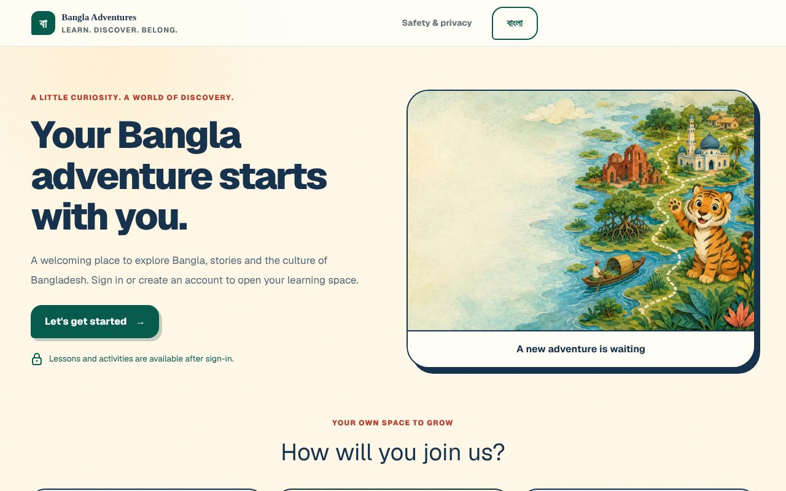
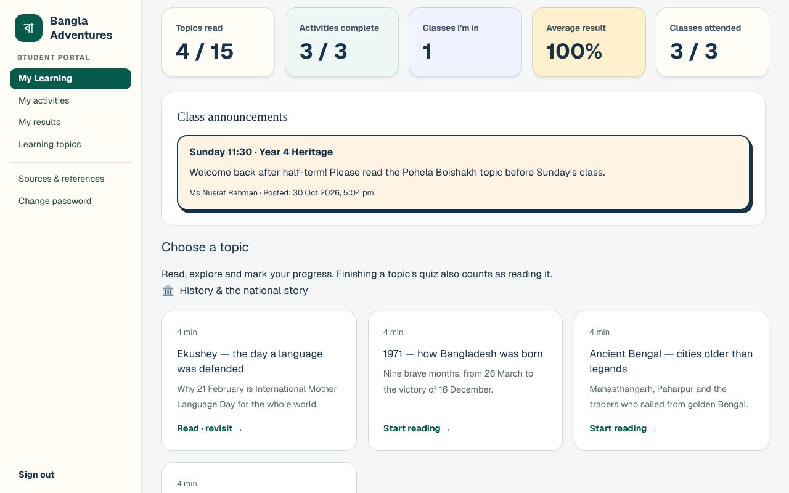
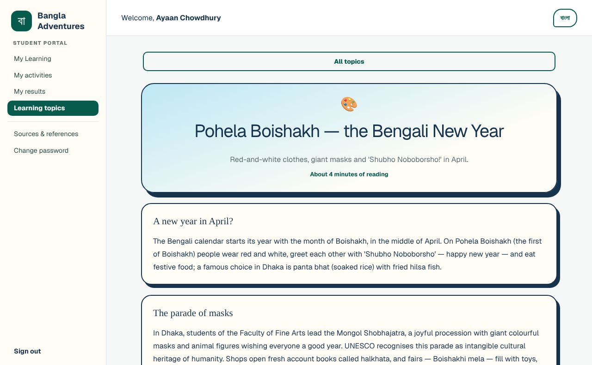
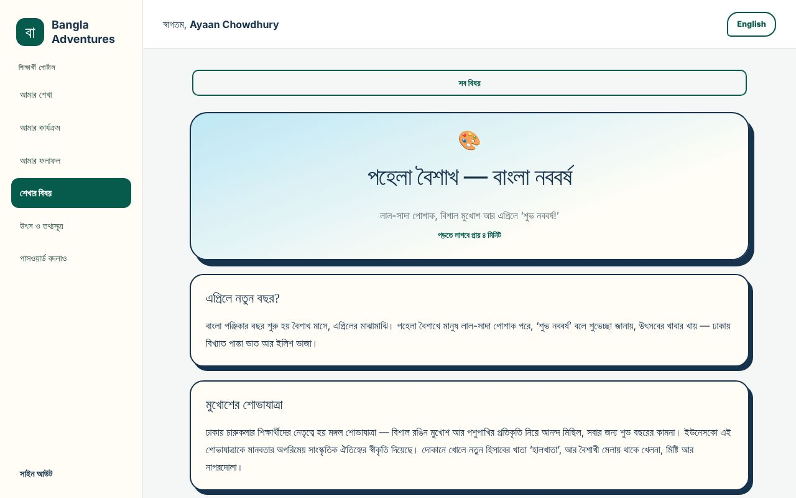
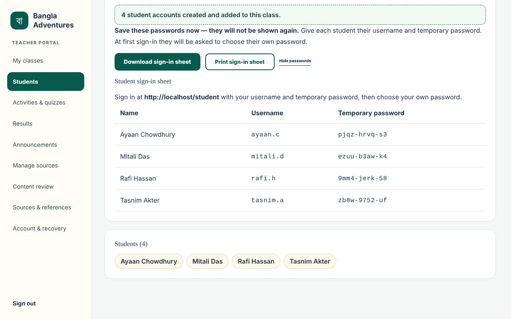
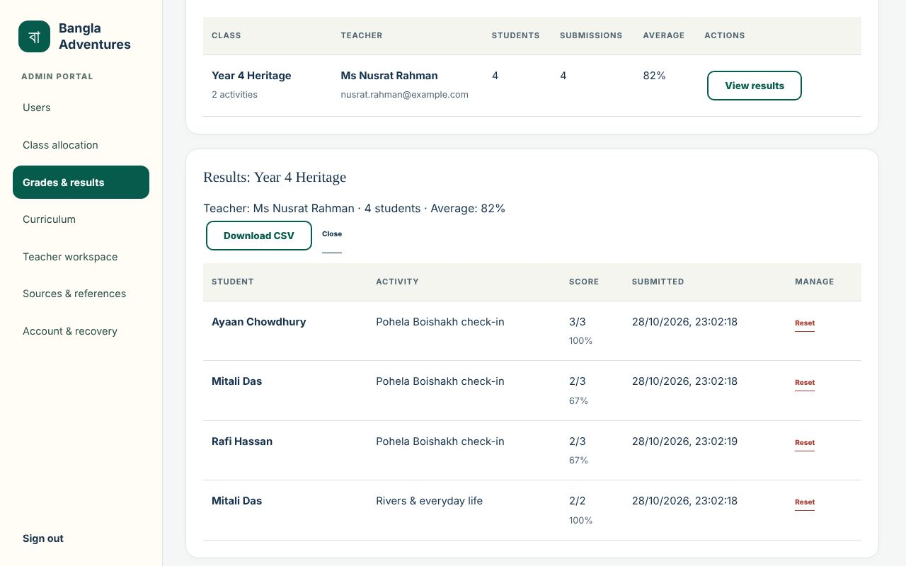
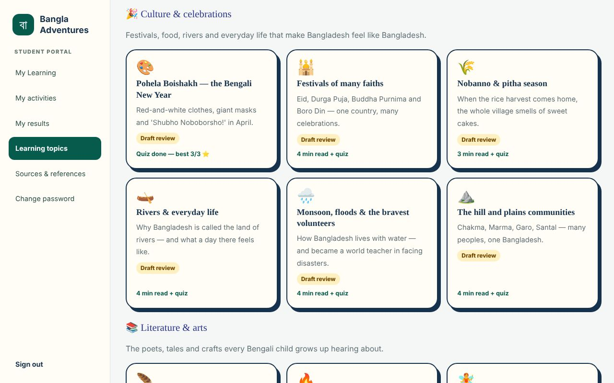
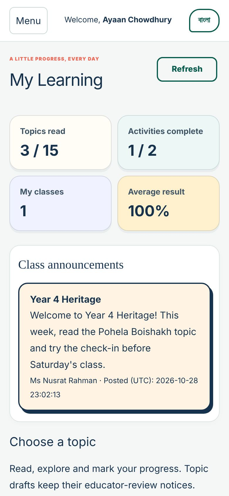
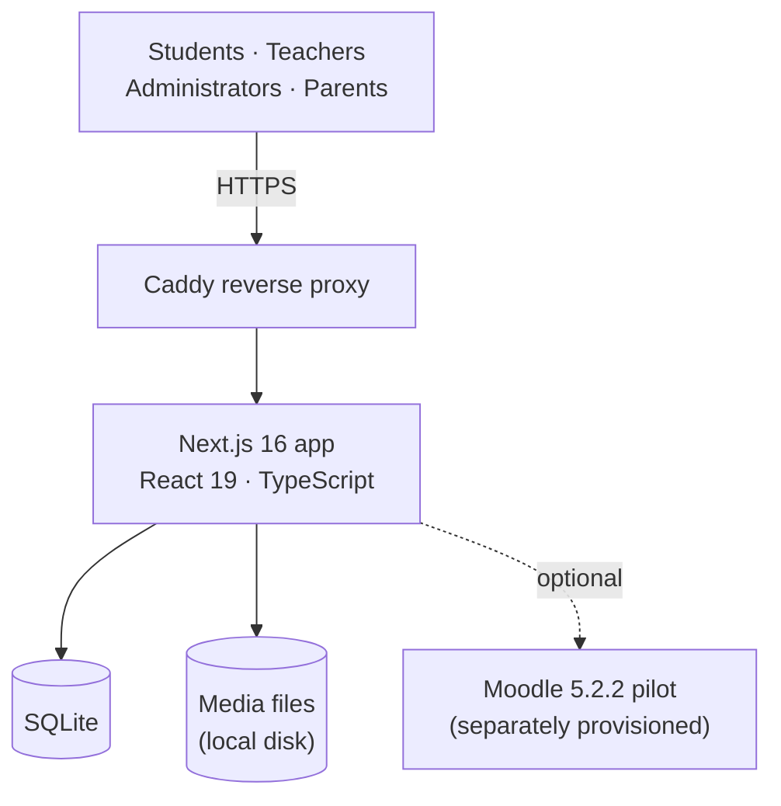

<a id="readme-top"></a>

<div align="center">

<p></p>

Bangladesh's culture, history and literature for Bangladeshi-heritage children outside Bangladesh, in English and Bangla.

[](https://github.com/omargad/Bangla-Adventure/actions/workflows/ci.yml)
[](https://github.com/omargad/Bangla-Adventure/actions/workflows/moodle-plugin.yml)


[Features](#features) · [Screenshots](#screenshots) · [Status](#honest-delivery-status) · [Get started](#run-the-application-locally-or-in-codespaces) · [Deployment](#current-deployment-and-handover) · [Contributors](#project-contributors) · [Documents](#key-documents)

</div>

> [!NOTE]
> An **ICT Project B capstone** for clients **Dr Tanjila Kanij** and **Faysal Alam**. Use the
> [deployment guide](docs/DEPLOYMENT.md) for the current custom application and the
> [handover guide](docs/HANDOVER.md) for client setup and release evidence.

## Features

The running deployment uses the **custom English–Bangla application**, following the owner's
20 September 2026 decision.

| Role | What they can do |
| --- | --- |
| 🧒&nbsp;**Students** | Use My Learning, approved learning topics by category, allocated classes, activities, results and attendance, and the sources their teachers add for their classes (in My activities and on Sources & references). A student given a temporary password must choose their own at first sign-in; My Learning, the learning pages and the student APIs stay closed until they do. |
| 🧑‍🏫&nbsp;**Teachers** | Join once an administrator approves them, find approved students by name or username and add them to a class with a tick, without class codes. Upload a CSV class list (`name`, optional `username`; up to 200 rows): a row with an existing student's username adds that student, and other rows create accounts with one-time temporary passwords. Student sign-in is rate-limited per account, so a whole class can sign in together from one school network. Read results as a gradebook (students A–Z down, activities across, `—` for work not submitted, activities done, average and attendance) with the topics each student has read, and take attendance by date with everyone ticked present by default. Write and edit topics, preview them in English and Bangla, and approve them for students (`/teach/topics`); preview, approve or withdraw the 18 lessons (`/studio`); and add sources for each of their classes. |
| 🛡️&nbsp;**Administrators** | Approve or decline self-registered students, parents and teachers; create accounts and reset forgotten passwords with one-time temporary passwords on a printable sheet (adults and students must choose their own at first sign-in). Import families from one CSV (`student name`, `parent name`, `parent email`) to create and link students and parents, optionally in a class, with a sign-in sheet per family. Manage family links and class allocation, and write, preview and approve topics and lessons like teachers. Keep each NCTB textbook's yearly link up to date at `/admin/sources` (audited). Review, export and reset grades and results in every class (`/admin/results`, with each class's gradebook and attendance), and open any class from the teacher workspace. Create a class for an approved teacher or give a class to another teacher at `/admin/classes` (both audited). |
| 👪&nbsp;**Parents** | See, read-only, the learning records, class attendance ("attended 3 of 5 classes") and class sources of the children an administrator has linked to them. |

Learning content requires sign-in. Students see only approved topics: a new or edited topic
stays hidden until a teacher or administrator has previewed all of it in English and Bangla
and approved it. The topics that shipped with the app are approved as a baseline and are
marked that way for staff, because they have not been individually reviewed.

`PLATFORM_MODE=legacy` is the configuration name for the custom application; it does not mean
the running portals are retired. The Moodle pilot remains an alternative implementation, not the
current live account and classroom system, and its hidden-course and publication gates remain
intact. See the [Moodle-first MVP plan](docs/MOODLE_FIRST_MVP.md) for that earlier plan.

## Screenshots

<table>
<tr>
<td width="50%" valign="top">

<p><b>Welcome page</b><br><sub>A bilingual front door for students, parents and teachers.</sub></p>
</td>
<td width="50%" valign="top">

<p><b>My Learning</b><br><sub>Progress, class announcements and topics in one place.</sub></p>
</td>
</tr>
<tr>
<td width="50%" valign="top">

<p><b>Topic reader</b><br><sub>Short readings that keep an honest educator-review notice.</sub></p>
</td>
<td width="50%" valign="top">

<p><b>The same topic in Bangla</b><br><sub>One tap switches the portal's language.</sub></p>
</td>
</tr>
<tr>
<td width="50%" valign="top">

<p><b>CSV class upload</b><br><sub>A class list becomes accounts and a printable sign-in sheet.</sub></p>
</td>
<td width="50%" valign="top">

<p><b>Results for administrators</b><br><sub>Every class's grades, CSV export and audited resets.</sub></p>
</td>
</tr>
</table>

<details>
<summary><b>More screenshots</b>: topics hub and phone layout</summary>

<br>

<table>
<tr>
<td width="75%" valign="top">

<p><b>Topics hub</b><br><sub>Culture, history and literature topics with review status and quiz results.</sub></p>
</td>
<td width="25%" valign="top">

<p><b>On a phone</b><br><sub>The student dashboard at 390&nbsp;px wide.</sub></p>
</td>
</tr>
</table>

</details>

<sub>Captured from a local build seeded with fictional demo accounts; names and passwords are made up.</sub>

## Honest delivery status

| Area | Status |
| --- | --- |
| ✅ Custom platform for learners, teachers, parents and admins | Deployed; role checks, staff allocation, learning progress and parent monitoring implemented |
| 🟡 Official NCTB catalogue and PDF audit | Source records implemented; a verified PDF is not an approved adaptation |
| 🟡 Bilingual topic prototypes | Implemented as drafts; educational and community review remains |
| 🟡 Bangla audio | Approved human recordings play first, then the device voice, then the bundled eSpeak voice; a neural provider (Azure) path is ready for a key; reviewed recordings remain incomplete |
| 🟡 Application deployment and operations | Existing-host reference configuration, portable service and Compose setup, and backup and restore tools included; actual hosting ownership, off-server scheduling and recovery evidence require operator handover |
| 🟡 Moodle pilot course | Installable hidden-course plugin implemented: 15 bilingual chapters, nine activities and nine questions |
| 🔒 Optional Moodle publication control | Draft validation passes; pilot release validation intentionally fails while 27 human-review gates are pending |
| ⬜ YouTube and media verification | Not complete; media excluded from the first pilot |
| ⬜ Curriculum, accessibility and child review | Not complete |
| ⬜ Privacy, safeguarding and legal approval | Not complete |

<sub>✅ implemented · 🟡 implemented, with review or handover outstanding · 🔒 deliberately gated · ⬜ not complete</sub>

> [!IMPORTANT]
> A successful build proves that the software compiles. It does not approve Bangla, historical
> claims, copyright, age suitability, accessibility or child safety.

## Client-aligned scope

The 10 August 2026 client meeting re-scoped the core away from a new language course. Community
Bangla schools already teach language; the missing resource is a systematic, English-first
culture/history/literature strand with optional Bangla translation and trustworthy NCTB evidence.

The pilot therefore does **not** use CEFR A1–C2 labels. CEFR can describe a future language
pathway, but it does not measure cultural or historical depth. The course instead states target
age/context, reading support, activity scaffolds, outcomes and teacher success criteria.

## Architecture



| Layer | Choice |
| --- | --- |
| Running application | Next.js 16, React 19, TypeScript |
| Running application storage | SQLite + local filesystem; single application instance |
| Optional Moodle pilot | Moodle 5.2.2 + MariaDB 10.11, separately provisioned |
| Current hosting | Linux service behind Caddy, HTTPS on an IP address |
| Handover requirements | Agreed hosting ownership, off-server backups, restore verification and named support/review owners |

Moodle core is used before optional plugins. The first pilot has no paid LMS, paid plugin, mobile
app or LTI dependency.

## Learning and reference surfaces

| Route | Pilot role |
| --- | --- |
| `/topics` | Approved bilingual topics by category, with a quiz that counts towards Topics read |
| `/studio` | Staff Lessons: preview the 18 lessons as students see them, approve or withdraw them, review human audio and video checks |
| `/teach/topics` | Staff Topics: write, edit, preview and approve topics |
| `/books` | Audited NCTB Book Bridge and precise source metadata |
| `/library` | Adult-facing textbook catalogue |
| `/resources` | External research register; not approved curriculum |
| `/safety` | Current safety/accessibility statements for review |

Learning/reference pages require a valid session; `/safety` remains public. If a future deployment
selects `PLATFORM_MODE=moodle`, the configured custom LMS routes redirect to Moodle and their data
APIs return `410 Gone`.

## Run the application locally or in Codespaces

Use **Node.js 22** (`.nvmrc` records the major version). No separate database server or Moodle
installation is needed for the custom app.

```bash
npm ci
npm run dev
```

Open <http://localhost:3000>. SQLite tables are created automatically on first use; a new
installation starts empty.

> [!WARNING]
> A Codespace is a development environment, not a production host for children or persistent
> application data. Real users, student records and uploaded media are intentionally absent from
> GitHub. Continuing an existing site requires its database and matching media to be restored
> privately.

<details>
<summary><b>Test the Moodle hand-off locally</b></summary>

<br>

Provide a local or HTTPS Moodle URL:

```dotenv
PLATFORM_MODE=moodle
MOODLE_URL=http://localhost:8080
NEXT_PUBLIC_MOODLE_URL=http://localhost:8080
```

Production accepts HTTPS only. See [`.env.example`](.env.example).

</details>

## Quality checks

```bash
npm run lint
npm test
npm run verify:moodle-pilot
npm run verify:moodle-plugin
npm run verify:moodle-infra
npm run build
npm run typecheck
npm run test:backup
npm run test:e2e
NEXT_DIST_DIR=.next-test npm run test:integration
```

<details>
<summary><b>Additional audits</b></summary>

<br>

```bash
npm run verify:media  # candidate YouTube IDs; run where YouTube is reachable
npm run verify:links  # external resource register
npm run fetch:nctb    # controlled NCTB ingestion; PDFs themselves are not lessons
```

</details>

CI includes application checks, backup/restore fixture tests and a disposable container
persistence smoke check. CI also validates the optional Moodle draft manifest; any workflow
publishing that pilot must call `verify:moodle-release`, and pending human gates must not be
bypassed. The custom application has separate human acceptance evidence in
[`docs/ACCEPTANCE.md`](docs/ACCEPTANCE.md).

> [!CAUTION]
> A workflow definition is not evidence of a passing run: retain the actual results for the
> release. Do not run type checking concurrently with builds or use production data in tests.

## First Moodle pilot

[`moodle/local/banglapilot/`](moodle/local/banglapilot/) contains an installable Moodle 5.2 local
plugin for:

1. Ekushey and the Language Movement;
2. Pohela Boishakh; and
3. folk tales and retelling.

Each candidate module has five substantial bilingual draft chapters, a three-question quiz and a
teacher-reviewed response. Official NCTB source anchors and nine mandatory gates cover source
mapping, Bangla, English adaptation, cultural/historical accuracy, age suitability, rights,
accessibility, media safety and a consented child pilot.

```bash
npm run verify:moodle-pilot   # validates a draft and reports blockers
npm run verify:moodle-plugin  # validates the installable Moodle plugin boundary
npm run moodle:package        # builds a checksummed local_banglapilot.zip
npm run verify:moodle-release # must fail until all review evidence is approved
```

The controlled lesson, manifest and GIFT sources are packaged under
[`moodle/local/banglapilot/data/`](moodle/local/banglapilot/data/). The seeder creates the hidden
course repeatably; it has no command that can publish it.

## Source and content boundaries

- [`app/nctb-books.ts`](app/nctb-books.ts) records current official source metadata and direct
  government-hosted downloads.
- [`app/nctb-content.ts`](app/nctb-content.ts) is an explicit review queue. Its lesson bridges
  remain `pending-educator-review`.
- [`content-sources/`](content-sources/) contains audit/extraction evidence, not learner-ready copy.
- Original accessible HTML must be written and reviewed for the diaspora audience; textbook scans
  are never embedded as the lesson interface.
- Stories, poems, images, recordings and video require exact rights, consent, attribution,
  accessibility and suitability evidence.

## Current deployment and handover

- **Existing website:** <https://31.56.120.148>. Portals: `/student`, `/teach`, `/admin`,
  `/family`. Confirm live readiness and ownership during handover; source files alone do not
  establish the current server state.
- **Setting up or taking over:** start with the [deployment guide](docs/DEPLOYMENT.md) and the
  [handover guide](docs/HANDOVER.md), then work through the checklist below.

<details>
<summary><b>Operator handover checklist</b></summary>

<br>

- **Current host reference:** [`infra/current-server/`](infra/current-server/) records the
  existing non-root loopback3300 service, Caddy site, health and certificate timers and persistent
  paths under `/var/lib/bangla-adventures`. It is historical host reference, not a portable
  installer. Preserve its database and media independently of build directories.
- **New installations:** use [`compose.yaml`](compose.yaml) or
  [`infra/custom-app/`](infra/custom-app/) following the [deployment guide](docs/DEPLOYMENT.md).
  Configure HTTPS `PUBLIC_ORIGIN`, persistent `DATABASE_PATH`, absolute `MEDIA_ROOT` and a
  consistent build and runtime `NEXT_DIST_DIR`. Never rebuild a running release; retain the previous one.
- **Backups:** the [backup and restore guide](docs/BACKUP_RESTORE.md) covers verified snapshots and
  restoration into a new directory. A real off-server destination, encryption and key custody,
  schedule, backup-age alerts and a recorded restore exercise still need to be configured and
  demonstrated on the intended deployment.
- **Client handover:** give the client a specific repository commit or release, the lockfile,
  setup and recovery runbooks, role demonstrations, test results and the
  [acceptance and known-issues record](docs/ACCEPTANCE.md). Roles and contribution evidence are
  recorded in the [contribution register](CONTRIBUTIONS.md).
- **Accounts and access:** provision the client's administrator only after confirming their
  account. Transfer credentials and recovery material separately and securely. The current host also
  serves other projects: use application-scoped access or dedicated client-owned hosting rather
  than transferring shared-server root access.
- **Reviews:** curriculum, privacy and safeguarding, media rights and independent accessibility
  review remain separate from software test results.

For the alternative Moodle deployment, use the [Moodle pilot deployment guide](infra/moodle/README.md);
its infrastructure and publication prerequisites still apply.

</details>

## Project contributors

Each team member's Jira work is credited below, and the import commits are authored by the Jira owner of each part, so GitHub's Contributors list and `git blame` follow Jira ownership.

<div align="center">

<table>
<tr>
<td align="center" valign="top" width="33%"><a href="https://github.com/bahaa11-prog"><br><b>Bahaa<br>Ghazi</b></a></td>
<td align="center" valign="top" width="33%"><a href="https://github.com/omargad"><br><b>Omar<br>Gad</b></a></td>
<td align="center" valign="top" width="33%"><a href="https://github.com/MAQ022"><br><b>Mohammed Ali A<br>Alqahtani</b></a></td>
</tr>
<tr>
<td align="center" valign="top" width="33%"><a href="https://github.com/MohammedAlAjmi24"><br><b>Mohammed<br>Alajmi</b></a></td>
<td align="center" valign="top" width="33%"><a href="https://github.com/Tlm0v"><br><b>Turki<br>Alahzmi</b></a></td>
<td align="center" valign="top" width="33%"><a href="https://github.com/104985376"><br><b>Dilsha<br>Nishadya</b></a></td>
</tr>
</table>

</div>

| Contributor | Jira items | Files | From prototype | Contribution areas |
| --- | ---: | ---: | ---: | --- |
| [Bahaa Ghazi](CONTRIBUTIONS.md#bahaa-ghazi)<br><sub>@bahaa11-prog</sub> | 19 | 12 | 4 | Project coordination, requirements, Jira management and QA; admin results |
| [Omar Gad](CONTRIBUTIONS.md#omar-gad)<br><sub>@omargad</sub> | 6 | 146 | 68 | Repository, final architecture/database, security, deployment and regression testing |
| [Mohammed Ali A Alqahtani](CONTRIBUTIONS.md#mohammed-ali-a-alqahtani)<br><sub>@MAQ022</sub> | 18 | 250 | 240 | Student learning, activities, progress, login integration and educational sources; technology research, initial architecture and UI review |
| [Mohammed Alajmi](CONTRIBUTIONS.md#mohammed-alajmi)<br><sub>@MohammedAlAjmi24</sub> | 22 | 140 | 118 | Teacher platform, CSV provisioning, class allocation and educational-resource research |
| [Turki Alahzmi](CONTRIBUTIONS.md#turki-alahzmi)<br><sub>@Tlm0v</sub> | 11 | 18 | 3 | Admin platform, portal organisation and initial user flows/wireframes |
| [Dilsha Nishadya](CONTRIBUTIONS.md#dilsha-nishadya)<br><sub>@104985376</sub> | 7 | 32 | 12 | Child-friendly UX, visual design, responsiveness and shared navigation |

The [contribution register](CONTRIBUTIONS.md) links every assigned item to its import commit, GitHub issue and repository files, and [docs/FILE_OWNERSHIP.md](docs/FILE_OWNERSHIP.md) lists the owner of each file.

> [!NOTE]
> *Files* counts the files each person authored in the import; *From prototype* counts those that were already in the August prototype. The counts cover 83 assigned tasks, stories and subtasks, checked against Jira on 28 October 2026; eight unassigned epics remain separate. Mohammed Ali A Alqahtani's count includes the three items recorded under a second Jira account, Mohammed Alqahtani. Disclosure: files already in the August prototype history (commits by `omargad`, 2–12 August 2026, before the Jira project began) are credited to their Jira assignees at the repository owner's request; see [CONTRIBUTIONS.md](CONTRIBUTIONS.md).

## Key documents

| Document | What it covers |
| --- | --- |
| [Deployment guide](docs/DEPLOYMENT.md) | Current custom application setup, upgrades and rollback |
| [Backup and restore](docs/BACKUP_RESTORE.md) | Database and media backup, verification and recovery drill |
| [Acceptance record](docs/ACCEPTANCE.md) | Reviewer ownership, evidence and client acceptance record |
| [Handover guide](docs/HANDOVER.md) | Release and account handover |
| [Contribution register](CONTRIBUTIONS.md) | Who did what, by Jira item, with import commits and files |
| [Moodle-first MVP plan](docs/MOODLE_FIRST_MVP.md) | Recovery decision, scope and definition of done |
| [Moodle plugin guide](moodle/README.md) | Plugin packaging, installation and release boundary |
| [NCTB content audit](docs/NCTB_CONTENT_AUDIT.md) | PDF and source audit, and its limits |
| [Client requirements, 10 August 2026](docs/CLIENT_REQUIREMENTS_2026-08-10.md) | Requirement traceability |
| [Media review process](docs/MEDIA_REVIEW.md) | Unverified-video and human-audio process |
| [Moodle pilot deployment](infra/moodle/README.md) | Alternative Moodle pilot deployment |

<div align="center">
<br>
<sub><b>Bangla Adventures</b> · শিখি। জানি। আপন হই। · Source: <a href="https://github.com/omargad/Bangla-Adventure">omargad/Bangla-Adventure</a> · <a href="#readme-top">Back to top ↑</a></sub>
</div>
