# Bangla Adventures — Administrator guide

This guide is for the school's Administrators: the office staff or lead teacher who looks
after Bangla Adventures for everyone else. As an Administrator you approve new accounts,
create accounts and reset passwords, import families, set up classes for teachers, keep the
NCTB textbook links up to date, and look after results and attendance in every class. You
also decide what students and parents see: no topic, lesson, recording, video or class
activity from a teacher reaches them until an Administrator has checked and approved it.
What you write or upload yourself is published at once, and you can let teachers' topics,
class activities and class sources publish without approval (see
[Who needs approval](#who-needs-approval)).

The pictures in this guide use made-up people and example addresses. Passwords, recovery
codes and the website address are blurred on purpose.

## Contents

1. [Before you start](#before-you-start)
2. [Setting up the first Administrator](#setting-up-the-first-administrator)
3. [Signing in](#signing-in)
4. [Approving or declining new accounts](#approving-or-declining-new-accounts)
5. [Creating an account](#creating-an-account)
6. [Resetting a password](#resetting-a-password)
7. [Other account tasks](#other-account-tasks)
8. [Importing families from a CSV file](#importing-families-from-a-csv-file)
9. [Classes: creating them and handing them over](#classes-creating-them-and-handing-them-over)
10. [Working inside any class](#working-inside-any-class)
11. [Keeping the NCTB textbook links up to date](#keeping-the-nctb-textbook-links-up-to-date)
12. [Results: reviewing, exporting and resetting](#results-reviewing-exporting-and-resetting)
13. [Attendance: checking and correcting](#attendance-checking-and-correcting)
14. [Approving content before students see it](#approving-content-before-students-see-it)
15. [Optional narration (computer voice)](#optional-narration-computer-voice)
16. [Recent changes (the record of actions)](#recent-changes-the-record-of-actions)
17. [Other pages in your menu](#other-pages-in-your-menu)
18. [Looking after your account](#looking-after-your-account)
19. [Switching language](#switching-language)
20. [Privacy and safety](#privacy-and-safety)
21. [Troubleshooting](#troubleshooting)
22. [Getting help](#getting-help)

## Before you start

You need:

- **A web browser** on a computer, such as Chrome, Edge, Firefox or Safari. A laptop or
  desktop is easiest for this work, because many pages have tables.
- **Your school's Bangla Adventures web address.**
- **An Administrator account.** Either the server operator set you up as the first
  Administrator (see the next section), or another Administrator made your account and gave
  it the Administrator role. If another Administrator made your account, they will give you a
  printed sheet with a temporary password.

Anyone else who creates their own account (students, parents and teachers) has to wait
until an Administrator approves it. That Administrator is you.

## Setting up the first Administrator

This is a **one-time step on the server**, done by whoever runs the server for your school.
You cannot do it from the website, and creating an account on the website never makes
anyone an Administrator. There are no ready-made Administrator passwords.

In short:

1. The person who will be the first Administrator creates a grown-up account on the
   website: on the home page, select **Create parent account**. Leave **Account type** as
   **Parent or carer**, fill in **Your name**, **Email** and **Password**, and select
   **Create account**. The page says **Account created — waiting for approval** and shows
   eight recovery codes. Keep them somewhere safe and private, then select
   **I’ve saved them — back to sign in**. The account cannot sign in yet.
2. The person who runs the server turns that account into an Administrator account. The
   steps are in [First administrator and recovery](../DEPLOYMENT.md#first-administrator-and-recovery)
   in the deployment guide.
3. The new Administrator signs in again at the web address that ends in
   `/grown-ups?returnTo=/admin&switchAccount=1`.

After that, you can make more Administrators yourself from the website (see
[Making someone an Administrator](#making-someone-an-administrator)).

## Signing in

1. Open the Administrator sign-in page: your school's web address followed by
   `/grown-ups?returnTo=/admin&switchAccount=1`. It shows the heading
   **Administrator sign in**. Bookmark it for next time.
2. Type your **Email** and **Password**.
3. Select **Sign in**.

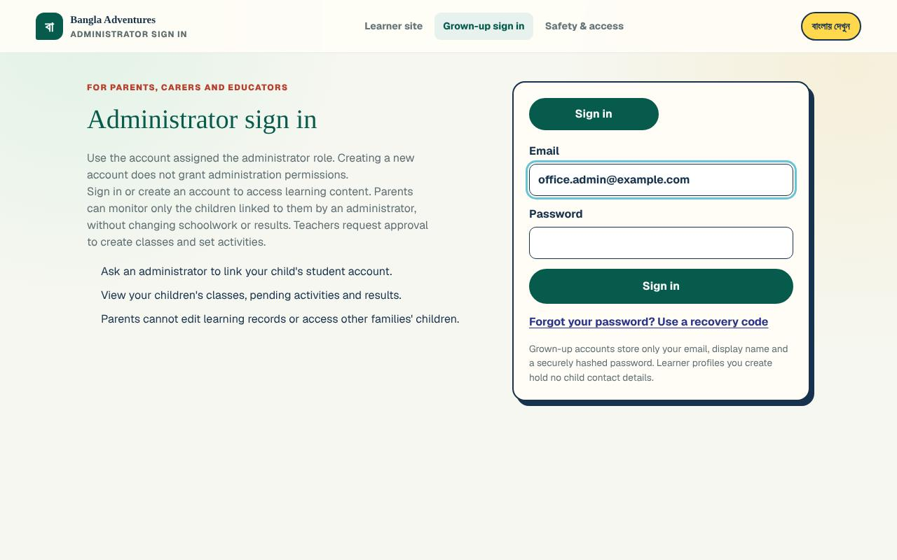

**What you'll see:** the **Users** page, with the heading **People make the adventure**.
The menu on the left has two groups:

- **Administration**: **Users**, **Class allocation**, **Grades & results**, **Lessons**,
  **Topics**, **Textbook links** and **Who needs approval**.
- **Teacher workspace**: **All classes** and **Home learners**.

Below them are **Sources & references** and **Account & recovery**. **Sign out** is at the
very bottom.

You can also sign in with **Teacher sign in** on the home page. You then arrive at
**All classes** instead; select **Users** in the menu.

### Your first sign-in with a temporary password

If another Administrator made your account, the first sign-in asks you to choose your own
password.

1. Sign in with your email and the **Temporary password** from your sheet.
2. On the page **Choose your own password**, type the **Temporary password** again.
3. Type a **New password** (at least 10 characters), then type it again in
   **Type the new password again**.
4. Select **Save my new password**.
5. The page **Save your new recovery codes** shows eight one-time codes. Select
   **Copy all codes** or write them down, and keep them somewhere safe and private.
6. Select **I’ve saved them — continue**. You arrive at the **Users** page.

The codes on your printed sheet stop working once you choose your own password. Keep the
new set instead.

### If you forget your password

There is no email reset. Recovery codes are the way back in.

1. On the sign-in page, select **Forgot your password? Use a recovery code**.
2. Type your **Email**, one unused **Recovery code** and a **New password** (at least 10
   characters).
3. Select **Reset password**.

**What you'll see:** you are signed in and taken to the **Users** page. That code is now
used up, and any other device signed in to your account is signed out.

If you have no recovery codes left, ask another Administrator to reset your password (see
[Resetting a password](#resetting-a-password)). If you are the only Administrator and have
lost both your password and your codes, ask the person who runs the server. The deployment
guide covers this under [First administrator and recovery](../DEPLOYMENT.md#first-administrator-and-recovery).

### Signing out

Select **Sign out** at the bottom of the left-hand menu. You go back to the sign-in page
for grown-ups (**Grown-up sign in** is highlighted at the top). Always sign out on a shared
computer.

## Approving or declining new accounts

Students, parents and teachers who create their own account cannot sign in until you
approve them. A teacher's own account arrives as a **Teacher request**. (The other guides
show what each person does: [students](student.md#creating-your-own-account),
[parents](parent.md#way-1-create-your-own-account) and
[teachers](teacher.md#asking-for-a-teacher-account).)

1. Select **Users** in the menu.
2. Find the box **Waiting for approval**. The number in brackets is how many people are
   waiting. Each person shows their name, their email (adults) or username (students), a
   label (**Parent**, **Student** or **Teacher request**) and when they signed up.
3. Check that you know who the person is. Approve only people you can identify.
4. Select **Approve**, or **Decline** if you do not recognise them.
5. A box asks you to confirm the change. Select **OK**.

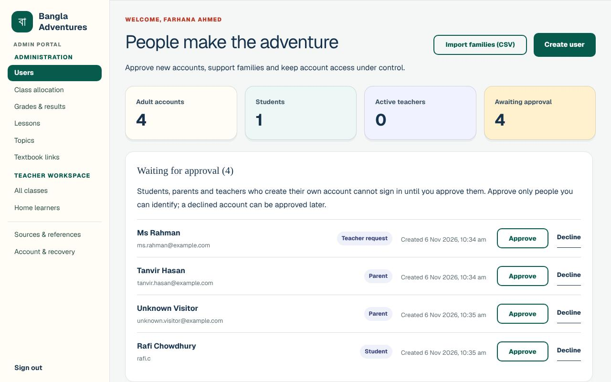

**What you'll see:**

- After approving: for example, *"Ms Rahman is approved as a teacher and can now sign in.
  The action has been recorded."* Parents and students get the same message without
  "as a teacher".
- After declining: *"Unknown Visitor was declined and cannot sign in. You can approve the
  account later. The action has been recorded."*
- The person disappears from **Waiting for approval**. The count **Awaiting approval** at
  the top of the page goes down.

**Changed your mind?** In the accounts list below, open the filter (it shows
**All accounts**) and choose **Declined**. A declined parent or student has an **Approve**
button. A declined teacher request says *"Teacher request declined along with the account"*
and has an **Approve as teacher** button instead.

Approving a parent does not link them to any children. To let a parent see their child,
link them (see [Linking a parent to a student](#linking-a-parent-to-a-student)) or import
the family from a CSV file.

## Creating an account

You can make an account for a parent, a teacher or a student. Nothing is sent by email: you
give the person a printed or copied sheet.

1. On the **Users** page, select **Create user**.
2. In **Account type**, choose **Parent**, **Approved teacher** or **Student**.
3. Type the **Display name**.
4. For a parent or teacher, type their **Email**. For a student, type a **Username**.
   Students do not need an email address or a birth date.
5. Select **Create account**.

**What you'll see:** the message *"Account created. Give the person their sign-in details
privately."* and a box called **Account created:** followed by the name. It holds the
sign-in sheet: the name, the email or username, the **Temporary password** and the
**Sign in at** address. Sheets for parents and teachers also list eight **Recovery codes**.

6. Select **Print sign-in details** to print the sheet, or copy the details somewhere safe.
   **The temporary password is shown only once.**
7. Select **Hide sign-in details** when you have finished. A box warns that the temporary
   password cannot be shown again. Select **OK**.

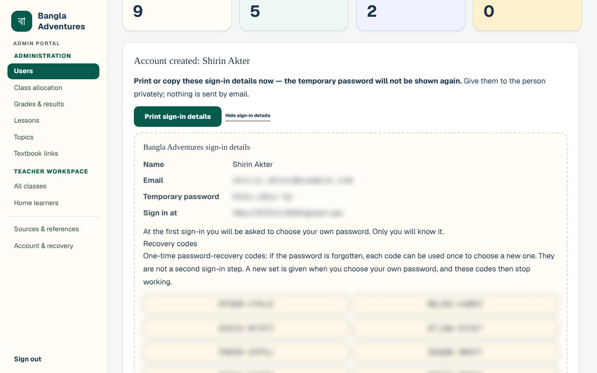

At their first sign-in, the person must choose their own password (see, for example,
[First sign-in](student.md#first-sign-in-choosing-your-own-password) in the Student guide).
Until they do, their row in the accounts list says **Temporary password not yet changed**.

## Resetting a password

Use this when a student, parent or teacher has forgotten their password. Students cannot
reset their own password, so they always come to you. Their sign-in page tells them:
*"Forgot your password? Ask your teacher or a grown-up to ask an administrator for a new
one."*

1. On the **Users** page, choose **Adults** or **Students** above the list.
2. Type a name, email or username in **Search users** and select **Search**.
3. In the person's row, select **Reset password**.
4. A box explains that they will be signed out everywhere and must choose a new password at
   their next sign-in. Select **OK**.

**What you'll see:** *"Password reset. The action has been recorded."* and a box called
**Password reset:** followed by the name, with a new **Temporary password**. Print it with
**Print sign-in details** or copy it, then select **Hide sign-in details**. Their row says
**Temporary password not yet changed** until they choose a new password.

## Other account tasks

Each row in the accounts list has buttons: **Edit**, **Suspend**, **Revoke sessions** and
**Reset password**. Student rows also have **Family access**. Most changes ask you to
confirm first, and most messages end with *"The action has been recorded."*

Your own row says **(you)** after your name. On it, **Suspend**, **Revoke sessions** and
**Reset password** are greyed out, and in **Edit** you cannot change your own **Role**.

Use the filter beside **Search** to show **All accounts**, **Waiting for approval**,
**Declined**, **Parent**, **Teacher**, **Administrator** or **Suspended**.

### Changing a name or role

1. Select **Edit** in the person's row.
2. In **Edit account**, change the **Display name** or, for an adult, the **Role**
   (**Parent**, **Teacher** or **Administrator**).
3. Select **Save changes** (or **Cancel**), then **OK** in the box that asks you to
   confirm.

**What you'll see:** *"Account updated. The action has been recorded."* Changing a role
signs the person out, so they sign in again with the new role.

### Making someone an Administrator

1. Create an account for them (choose **Parent** in **Account type**), or find their
   existing adult account.
2. Select **Edit**, choose **Administrator** in **Role** and select **Save changes**.

Their row now shows **Administrator**. When they sign in, they arrive at the **Users** page.
Give Administrator access only to people the school trusts with every family's details.

### Suspending and reactivating

**Suspend** stops someone signing in. Their learning records are kept. The row then shows
**Suspended** and a **Reactivate** button. Nothing on this page deletes an account for
good. The note at the end of **Recent changes** says so: *"Suspension preserves learning
records. No permanent user deletion is performed here."*

### Revoke sessions

**Revoke sessions** signs the person out on every device straight away. Use it if they
signed in on a shared or lost device. Their password stays the same.

### Linking a parent to a student

1. Select **Students** above the list, then **Family access** in the student's row.
2. Type the **Parent account email**.
3. Tick **I verified this adult is authorized to view this student's learning records.**
4. Select **Link parent**.

**What you'll see:** *"Parent linked. Their dashboard can now show this student's learning
records."* The parent's name appears in the box, with **Remove access** beside it. A linked
parent can see the student's classes, activities and results, but cannot change them (see
[Seeing your children's learning](parent.md#seeing-your-childrens-learning) in the Parent
guide).

## Importing families from a CSV file

This makes accounts for students and their parents in one go, and links each student to
their parent. You can also put all the students into one class at the same time.

### Preparing the file

Make a spreadsheet and save it as a CSV file (most spreadsheet programs can save or
download a sheet in CSV format). The first row must be a header row with these three
columns:

| student name | parent name | parent email |
| --- | --- | --- |
| Maya Khan | Sadia Khan | sadia.khan@example.com |
| Arif Khan | Sadia Khan | sadia.khan@example.com |
| Nadia Islam | Karim Islam | karim.islam@example.com |

As plain text, the same file looks like this:

```
student name,parent name,parent email
Maya Khan,Sadia Khan,sadia.khan@example.com
Arif Khan,Sadia Khan,sadia.khan@example.com
Nadia Islam,Karim Islam,karim.islam@example.com
```

Things to know:

- One student per row, up to 200 students per file.
- Brothers and sisters share one parent account. Give the **same parent email and the same
  parent name** on each of their rows.
- You may add a fourth column, **student username**, to choose usernames. Without it, the
  username is made from the name (for example, a name plus some numbers).
- If a name contains a comma, put it in double quotes, for example `"Rahman, Maya"`.
- Select **Download the family CSV template** on the import panel for a ready-made example
  file.

### Uploading the file

1. On the **Users** page, select **Import families (CSV)**.
2. In **Family list (CSV file)**, choose your file.
3. If you want, choose a class in **Also add the students to a class (optional)**. Each
   class is listed with its teacher, for example *Sunday 11:30 Level 2 · Ms Rahman*. Leave
   **No class for now** to skip this. (Until a class has been created, **No class for now**
   is the only choice. You can add the students to a class later: see
   [Adding students to the class](#adding-students-to-the-class).)
4. Select **Upload and create accounts**.

**What you'll see:** a message such as *"3 student accounts and 2 new parent accounts
created. The students were added to Sunday 11:30 Level 2."* Under it is a sign-in sheet for
each family: the parent's email and temporary password, and each child's username and
temporary password. The sheet is in English and Bangla.

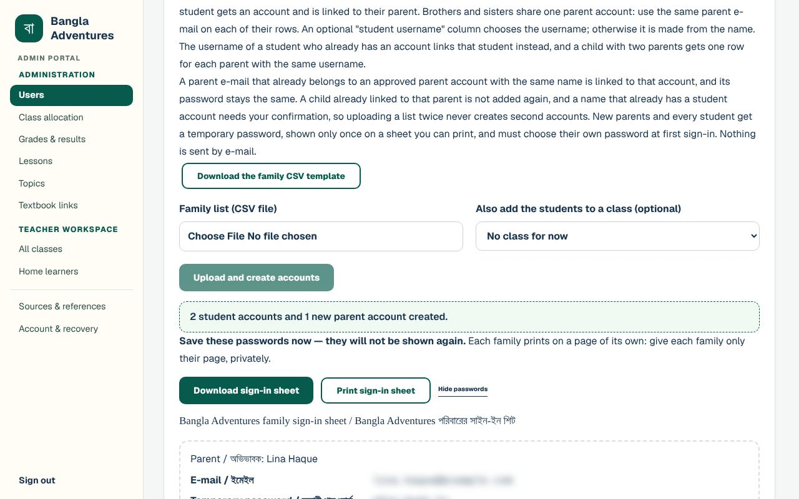

5. **Save these passwords now — they will not be shown again.** Select
   **Print sign-in sheet**, or **Download sign-in sheet** to save them as a file
   (`family-sign-in-sheet.csv`). Each family prints on a page of its own. Give each family
   only their own page, privately.
6. Select **Hide passwords** when you have finished. A box warns that the passwords cannot
   be shown again. Select **OK**.

Everyone chooses their own password at their first sign-in. The Parent guide explains the
sheet to families (see
[Way 2: the school creates your account for you](parent.md#way-2-the-school-creates-your-account-for-you)).

**If something is wrong in the file**, nothing is created. The panel says *"Nothing was
created. Fix the rows listed and upload the file again."* Below it, each problem is listed
with its line number (line 1 is the header row), for example: *"Line 3: Parent e-mail
"sadia.khan-at-example" is not a valid e-mail address."* Fix the file and upload it again.

**A parent who already has an account** (an approved parent account with the same name and
email) is linked to their new child, and their password does not change. The message says,
for example, *"1 student account and 0 new parent accounts created. 1 existing parent account
was linked."* Their sheet says *"Existing account, password unchanged"*.

**Uploading the same list twice** does not make second accounts. Nothing is created, and
the list of problems explains each line, for example: *"Line 2: "Tara Haque" is already
linked to this parent as tara.haque4010. Remove this row: the student already has an
account. To put them in a class, use "Allocate students" on that class."*

## Classes: creating them and handing them over

Teachers can make their own classes, but you can also make a class for a teacher, and move
a class to a different teacher. Select **Class allocation** in the menu. The page is called
**Classes and allocation**.

The teacher must already have an approved teacher account. If there is none, the page says
*"There are no approved teachers yet. Approve a teacher account in Users first."*

### Creating a class for a teacher

1. In **Create a class for a teacher**, type the **Class name** (for example "Sunday 11:30
   Level 2").
2. Choose the **Teacher**.
3. Select **Create class**.

**What you'll see:** *"Sunday 11:30 Level 2 was created for Ms Rahman. Add its students
below."* The new class is selected in **Choose a class**.

### Adding students to the class

1. Under **Allocate students**, type a name or username in **Find students**, or leave it
   empty to see everyone who can be added.
2. Tick the students. **Select all shown** ticks everyone in the list.
3. Select **Add selected** (the button shows how many you ticked).

**What you'll see:** for example *"2 students added to this class."* They appear under
**Students in this class**. The class appears on their dashboard straight away; no class
code is needed.

To take a student out of the class, select **Remove allocation** beside their name and
select **OK**. They leave the class list, results and attendance, but their work is kept
and comes back if they are added again.

Further down, **Add students from a CSV file** makes new student accounts for this class
from a list with a "name" column (and, optionally, a "username" column). Choose the file in
**Student list (CSV file)** and select **Upload and create accounts**. The message is, for
example, *"1 student account created and added to this class."* The temporary passwords are
shown once, as with the family import. The file format is the same one teachers use (see
[Adding students from a CSV class list](teacher.md#adding-students-from-a-csv-class-list) in
the Teacher guide).

### Handing a class to another teacher

1. In **Choose a class**, pick the class.
2. The box **Class teacher** shows the current teacher. In **Change teacher**, choose the new
   teacher.
3. Select **Save teacher**.
4. A box asks you to confirm. It explains that the class's students, activities,
   announcements, results and attendance stay with the class, and that the old teacher will
   no longer be able to open it. Select **OK**.

**What you'll see:** *"Saturday 10:00 Level 1 is now taught by Mr Das."*

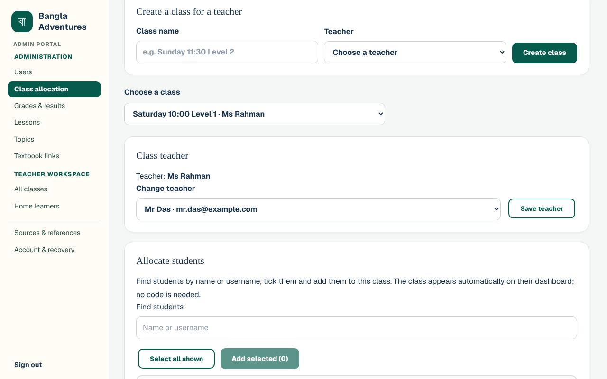

## Working inside any class

Administrators can open every teacher's class.

1. Select **All classes** in the menu (under **Teacher workspace**).
2. Type in **Find a class** to narrow the list. Each card shows the class name, its teacher,
   and how many students, activities and submissions it has.
3. Select a class card.

The menu now shows **Current class** with the class's sections: **Students**,
**Activities & quizzes**, **Results**, **Attendance**, **Announcements** and
**Class sources**. Select **← All classes** to go back. These sections work as they do for
teachers (see the [Teacher guide](teacher.md)).

In a class you can, for example:

- **Post an announcement:** in **Announcements**, type your message in the large box at the
  top (it shows an example, *"e.g. This term's theme is festivals — read the Pohela Boishakh
  topic!"*, until you start typing). In **Who can see it**, choose
  **Everyone in the class (students and parents)**, **Students only** or **Parents only**,
  and select **Post**. The message is, for example, *"Announcement posted to everyone in the
  class."* The announcement shows "Posted by" with your name. **Remove** takes an
  announcement down after you confirm.
- **Review class activities and class sources** before students see them (see
  [Class activities and class sources](#class-activities-and-class-sources)).
- **Correct attendance** (see [Attendance](#attendance-checking-and-correcting)).
- **Delete the class** with **Delete class**. A box asks you to confirm, because the
  class's activities and submissions are deleted with it. Select **OK**, and you go back to
  **All classes**. This cannot be undone, so use it with care.

## Keeping the NCTB textbook links up to date

The NCTB publishes new textbook editions each academic year. On **Textbook links** you paste
this year's link for each book. Students, parents and teachers then see the new link in
**Sources & references**, the textbook library and each topic's sources.

1. Select **Textbook links** in the menu.
2. Find the book. Each book shows where readers go now, for example
   *"Readers now go to: Official NCTB page"*.
3. Paste the new link in the box. For a book that covers several classes, there is a box for
   the **Whole book (all classes)** and one for each class. A class's own link is used
   first; the whole-book link is used for any class without one.
4. Select **Save link** beside that box.

**What you'll see:** *"Link saved. Sources & references, the textbook library and topic
sources now use it."* The book now says *"Readers now go to: Your link"* and
"Last changed by" your name and the date.

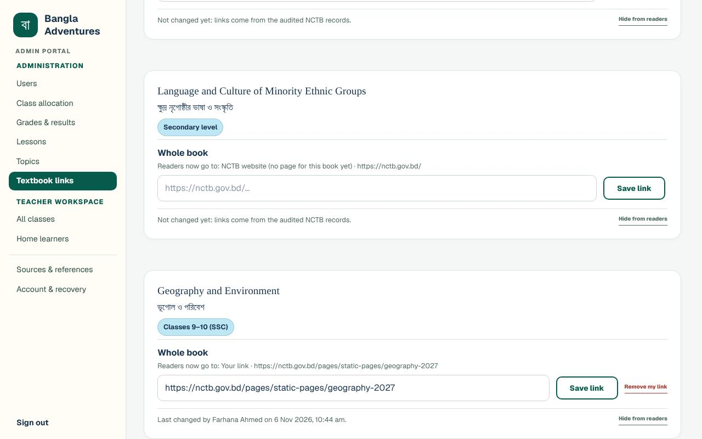

Good to know:

- If you paste a link that is not on the NCTB website, a note warns you: *"This link is not
  on the NCTB website (nctb.gov.bd). You can still save it, but check that it is the
  official textbook before students use it."*
- **Remove my link** goes back to the original link: *"Your link was removed. Readers see the
  official NCTB page again."*
- **Hide from readers** hides a book from readers (*"Hidden from readers. You can show it
  again below."*). The book moves to **Hidden sources** near the bottom of the page. Select
  **Show to readers** there to bring it back.
- For a new NCTB book that is not listed, use **Add a source** at the bottom of the page.
  Give the **Title (English)**, **Title (Bangla)**, **Classes (English)**,
  **Classes (Bangla)**, **Level** and **Link**, then select **Add source**. The message is
  *"Source added. Readers see it in Sources & references and the textbook library."*
- Teachers add links for their own classes under **Class sources** in their class, not here.

Every change on this page is listed under **Recent changes** on the **Users** page.

## Results: reviewing, exporting and resetting

Select **Grades & results** in the menu.

1. The table **Results by class** lists every class with its **Teacher**, **Students**,
   **Submissions**, **Average** and **Attendance**. Type in the search box to find a class
   or teacher.
2. Select **View results** in a class's row.

**What you'll see:** **Results:** and the class name, with the teacher, number of students
and average. Below it:

- **Gradebook and attendance**: one row per student, with **Done**, **Average**,
  **Attendance** (for example "2 of 2") and a column for each activity. A dash (—) means
  not submitted yet. The average counts submitted work only. Use **Find a student** to
  search. Please note: the gradebook has a column for every activity in the class,
  including ones that are still waiting for approval or were sent back, and **Done** counts
  them too. A student who has done every published activity can therefore show, for
  example, "1/2".
- **Submissions**: each submission with the **Student**, **Activity**, **Score** and when it
  was **Submitted**.

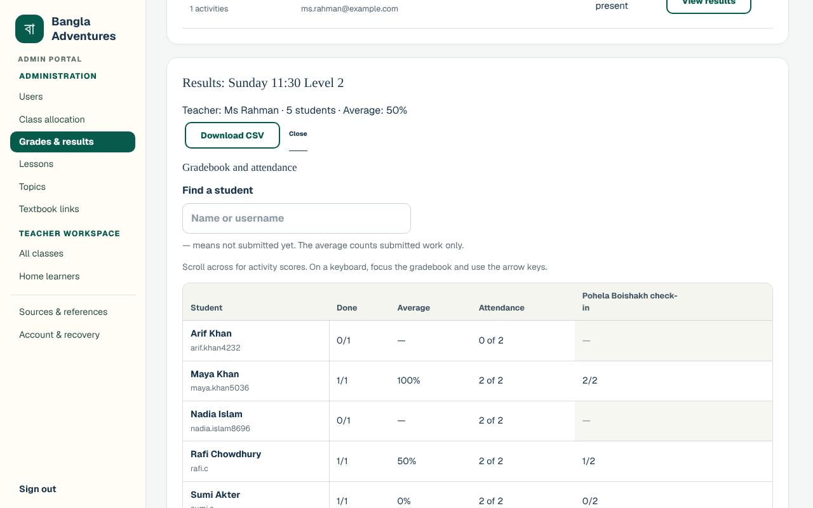

### Downloading a class's results

Select **Download CSV**. The file is named after the class and ends in `-grades.csv`. It
opens in a spreadsheet and lists, for each student, the activity, score, total, percentage,
when it was submitted, how much work is done, and their attendance.

### Letting a student try an activity again

1. In **Submissions**, find the row and select **Reset**.
2. A box warns that the score is deleted and the student can submit again. Select **OK**.

**What you'll see:** *"Submission reset. The student can submit the activity again."* The
reset is recorded under **Recent changes** on the **Users** page as "Quiz answers reset".

Select **Close** to close the class's results.

## Attendance: checking and correcting

The **Attendance** column on **Grades & results** shows each class's attendance, and the
gradebook shows each student's. To correct a day's attendance, open the class:

1. Select **All classes**, open the class, then select **Attendance**.
2. In **Class date**, choose the date of the class.
3. For a date that has not been saved yet, everyone starts ticked as present. Untick
   students who were absent, and tick anyone who was marked absent by mistake. The count,
   for example "4 of 5 present", changes as you go, and **Changes not saved yet** reminds
   you to save.
4. Select **Save attendance for** (the button shows the date).

**What you'll see:** for example *"Attendance saved for Sun, 1 Nov 2026: 5 of 5 present."*
and "Last saved by" with your name and the time. **Past sessions** lists each saved date,
with an **Open** button to look at that day.

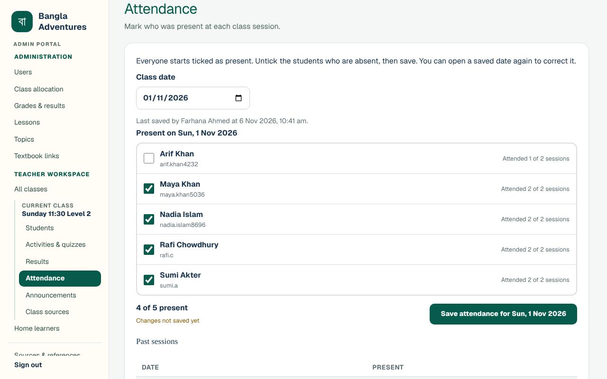

Each save, including a correction, is listed under **Recent changes** as "Attendance saved",
with the class and who saved it. The entry does not say which students changed: the sheet
shows only the latest marks. If a correction matters, keep your own note of what you changed
and why.

## Approving content before students see it

Teachers write and submit learning content. Students and parents see it only after an
Administrator approves the exact version. On a new installation, all 15 topics and all 18
lessons start as waiting for approval, so none of them reaches students until you approve
it. The [Content review pack](../CONTENT_REVIEW_PACK.md) helps you plan that first review: who
checks what, the order, and a worksheet listing every topic and lesson.

You never approve your own work: a topic you write or edit, a recording you upload and a
class activity or link you add are published as you save them, and **Recent changes**
records them as approved by you. Only an active Administrator who has chosen their own
password publishes this way.

| What | Where to review it | What you decide |
| --- | --- | --- |
| Topics (short readings with a quiz) | **Topics** | Approve, send back with a note, or withdraw |
| Lessons (the 18 adventure lessons) | **Lessons** | Approve the revision, or withdraw |
| Recordings of real voices | **Lessons**, inside the lesson | Approve after listening, or stop using it |
| Lesson videos | **Lessons**, inside the lesson, **Video check** | A separate video decision |
| Class activities and quizzes | **All classes**, in the class, **Activities & quizzes** | Approve, or send back with a note |
| Class sources (links for one class) | **All classes**, in the class, **Class sources** | Approve, or send back with a note |
| Whether teachers' topics, class activities and class sources wait for you | **Who needs approval** (also on the **Topics** page) | Switch approval on or off for each |

Approving the text of a lesson does **not** approve its video. Each video needs its own
decision. The longer technical explanation is in [Content approval](../CONTENT_APPROVAL.md).
The [Teacher guide](teacher.md) shows how teachers submit each kind of content.

### Topics

Teachers write topics as described in
[Writing topics in English and Bangla](teacher.md#writing-topics-in-english-and-bangla).

1. Select **Topics** in the menu. (The older address ending `/admin/curriculum` opens this
   same page.)
2. Under **Waiting for approval**, select **Preview & review** beside a topic. (On a new
   installation, the 15 built-in topics say they were written by *a former staff member*.
   That is normal.)
3. Read the whole topic in the **Student view preview**. Use **English**, **বাংলা** and
   **Side by side** to read both languages. **What changed** tells you what is new.
4. Read the quiz too. It is at the end of the preview, as students will see it.
5. Under **Your decision**, tick **I have read the whole topic, including its quiz, in
   English and Bangla**. The approve button stays greyed out until you tick it.
6. Select **Approve and publish to students**.

**What you'll see:** *"Approved. Students now see version 1 of this topic."*
**Version history** lists who wrote the version and that you reviewed it.

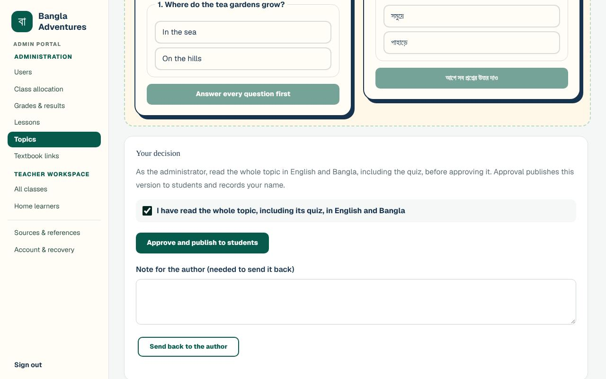

**To send it back** instead: type in **Note for the author (needed to send it back)** and
select **Send back to the author**. The message is *"Sent back to the author with your note.
Students keep seeing the approved version."* The topic list then shows
**Sent back · not published**.

**To take an approved topic away from students:** open it, type in
**Why are you withdrawing it? (needed)** and select **Withdraw from students**. The message
is *"Withdrawn. Students and parents no longer see this topic. Approve it again once it is
fixed."* To bring it back, tick the reading box again and select
**Approve again and show to students**. The message is *"Approved again. Students see this
topic once more."*

### Your own topics

1. On the **Topics** page, select **+ New topic**, or **Edit** beside a topic. The note at
   the top of the form says *"As an administrator, your own topic does not wait for
   approval: students see it as soon as you save it."*
2. Fill in the form as a teacher would (see
   [Writing a new topic](teacher.md#writing-a-new-topic)).
3. Select **Save and publish to students**.

**What you'll see:** *"Published as version 1. Students see it now: an administrator's own
topics do not wait for approval."* (with the version number). The preview says
*"Published at once by"* your name, and **Version history** says
*"Published at once (an administrator's own edit)"*.

If a teacher's edit of the topic is still waiting, the form starts from it and says
*"Your changes build on this waiting version, so they include its changes. Saving publishes
your version and marks version 2 as replaced."* (with its version number). After saving, the
message adds *"Version 2, which was waiting for approval, is included in it and is marked as
replaced."*, and **Version history** shows that version as **Replaced by a newer version**.
Editing a withdrawn topic shows it to students again when you save: the form warns
*"This topic is withdrawn: saving publishes your version and shows the topic to students
again."*

### Who needs approval

Select **Who needs approval** in the menu, under **Administration**. The box
**Who needs approval** holds three switches, and the same box is at the top of the **Topics**
page:

- **Teachers' topics need an administrator's approval**
- **Teachers' class activities need an administrator's approval**
- **Teachers' class sources need an administrator's approval**

Each is **On** to start with. What each means:

- **Topics, on:** *"a topic a teacher writes or edits waits on the Topics page until an
  administrator reads all of it and approves it."*
- **Topics, off:** *"a topic a teacher writes or edits is published to students as soon as
  they save it. Each one is still recorded in Recent changes, and you can withdraw a topic at
  any time. A teacher's edit of a withdrawn topic still waits for an administrator."*
- **Class activities, on:** *"an activity or quiz a teacher adds to their class waits in
  Activities & quizzes until an administrator approves it."*
- **Class activities, off:** *"an activity or quiz a teacher adds to their own class is
  published to the class as soon as they save it, and students answer it while it is open.
  Each one is still recorded in Recent changes, and you can withdraw an activity at any
  time."*
- **Class sources, on:** *"a link a teacher adds or edits in Class sources waits until an
  administrator approves it."*
- **Class sources, off:** *"a link a teacher adds or edits in their own class is shown to the
  class's students and their parents as soon as they save it. Each one is still recorded in
  Recent changes, and you can withdraw a source at any time. A teacher's edit of a source you
  sent back or withdrew still waits for an administrator."*

Teachers' lessons, recordings and videos always wait for you, and what you write or add
yourself is always published as you save it.

To change a switch, select it. Under each switch the box shows *"Last changed by"* with the
name and date.

**What you'll see** when you turn one off, for example the topics switch: *"Approval for
teachers' topics is off. Teachers' new topics and edits are now published to students as soon
as they save them."* If work is already waiting, it adds how much, for example *"2 topics are
still waiting for approval: turning approval off does not publish them, so an administrator
still reviews them below."* or *"1 class activity is still waiting for approval: turning
approval off does not publish it, so an administrator still reviews it in its class (All
classes, then Activities & quizzes)."* That work keeps waiting until you approve it or send it
back, and the note stays under the switch while it is off.

When you turn one on again, for example: *"Approval for teachers' class activities is on.
Teachers' new activities wait for an administrator again."* Only what teachers save from then
on waits; what was already published stays published. Each change appears in
**Recent changes** as "Approval setting changed". Teachers see on their own **Topics** page,
and in **Activities & quizzes** and **Class sources** in their class, whether their work waits
or is published as they save it.

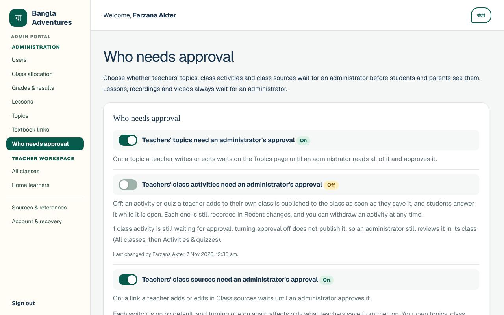

### Lessons

1. Select **Lessons** in the menu. The boxes at the top count, among other things, the
   lessons **Available to students**, the lessons **Hidden from students** and the
   **Recordings waiting**.
2. Select **Preview lesson** beside a lesson. Each lesson shows its status, for example
   **Waiting for approval · hidden from students**.
3. In the **Student view preview**, open **every part** of the lesson: **Overview**,
   **Listen**, **Read**, **Speak**, **Write**, **Watch** and **Mastery**. Switch between
   **English** and **বাংলা** to read both.
4. Under **Your decision**, check that it says **Parts of the lesson opened: 7 of 7**.
5. Tick **I have reviewed the whole lesson in English and Bangla**. The tick box stays
   greyed out until all 7 parts have been opened. You can add a **Note (optional)**.
6. Select **Approve revision for students** (for a lesson that was approved before and
   withdrawn, the button says **Approve for students**).

**What you'll see:** a message that depends on what students could open before:

- a lesson approved for the first time: *"Approved. Students can now open this lesson."*;
- a lesson approved before and withdrawn: *"Approved. Students can open this lesson again."*;
- a new revision of a lesson students already see: *"Approved. Students now see revision 2 of
  this lesson."* (with its revision number);
- a review of a lesson students already see: *"Review recorded. Students keep seeing this
  lesson, now approved under your name."*

The **Approval history** records your name and the date.

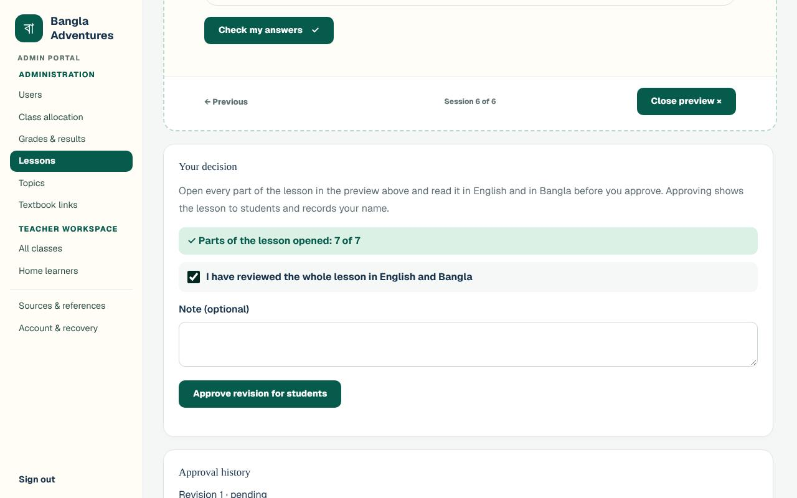

**To withdraw an approved lesson:** type in **Why are you withdrawing it? (needed)** and
select **Withdraw from students**. Students and parents stop seeing it straight away, and
their saved progress is kept. The lesson list then shows **Withdrawn · hidden from students**
with your reason.

### Recordings of real voices

Teachers can upload recordings of a real person reading part of a lesson (see
[Sending in a recording](teacher.md#sending-in-a-recording) in the Teacher guide). Learners
hear an approved recording instead of the computer voice.

1. Select **Lessons**. The box **Recordings waiting for review** lists every waiting
   recording. Select **Review in the lesson** beside one.
2. Find **Human audio recordings**. A waiting recording says **Waiting for review**, with
   the speaker's name and "consent confirmed".
3. Play the whole recording with the play button beside it.
4. Tick **I listened to the whole recording**. This tick box stays greyed out until the
   recording has played to the end, and **Approve recording** stays greyed out until you
   tick it.
5. Select **Approve recording**.

**What you'll see:** *"Recording approved. Learners now hear it for this part of the lesson
instead of a computer voice."* The recording now says **Approved · in use**. To stop using
it later, select **Stop using it**; it then says **Retired**.

**Your own recording** does not wait: under **Upload a recording**, fill in the form as a
teacher would and select **Upload and approve**. The form notes *"As an administrator, your
own recording is approved when you upload it and replaces the approved recording for that
part of the lesson."*, so listen to the file before you upload it. The message is
*"Uploaded and approved. Learners now hear it for this part of the lesson instead of a
computer voice."*

### Lesson videos (a separate decision)

Lessons can include a YouTube video. On a new installation, learners see no video until an
Administrator records a decision for it. The lesson list shows "video review pending" for
any lesson whose video still needs a decision.

1. Open the lesson in **Lessons** and scroll to **Video check**. Until someone checks it,
   it says *"Nobody has checked this video yet. Learners do not see this video, and no
   replacement is set."*
2. Select **Watch on YouTube** and watch the whole video.
3. Choose a **Decision**: **Approved**, **Replace this video** or
   **Unavailable on YouTube**.
4. Choose **Captions**: **Available**, **Partial or automatic only** or **Missing**.
5. Choose **Suitable for children?**: **Suitable**, **Needs a grown-up watching** or
   **Unsuitable for children**.
6. If you want, paste a **Replacement YouTube link (used when this video is taken down)**
   and add **Notes**.
7. Select **Save video check**.

**What you'll see:** *"Video check saved."* and "Last checked by" your name, with
*"Learners see this video."* Choosing **Replace this video**, **Unavailable on YouTube** or
**Unsuitable for children** takes the video out of the lesson for learners.

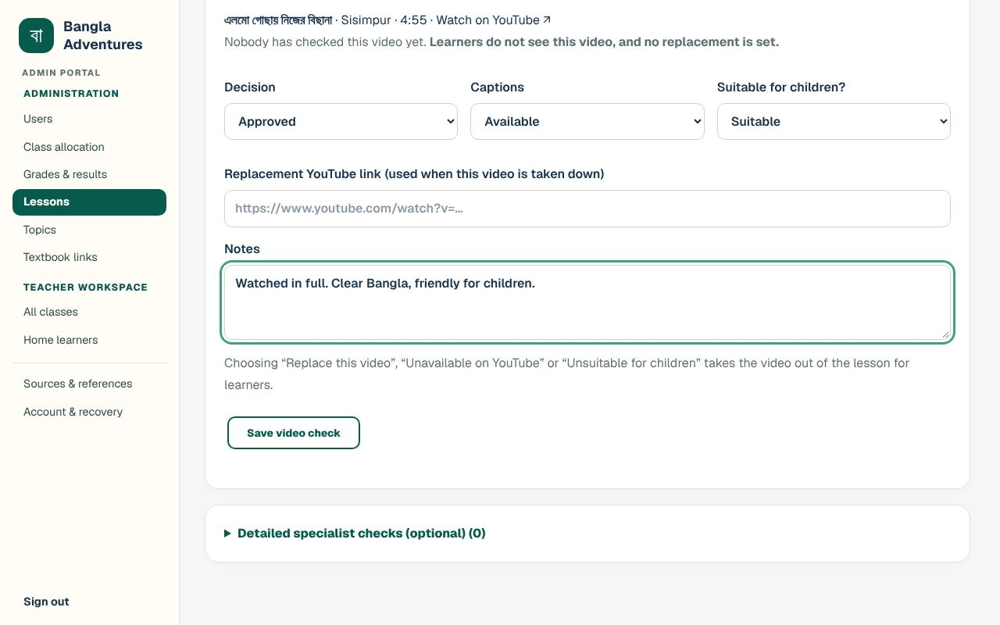

### Class activities and class sources

Teachers submit activities, quizzes and links for their own class (see
[Setting activities and quizzes](teacher.md#setting-activities-and-quizzes) and
[Adding class sources](teacher.md#adding-class-sources) in the Teacher guide). Students and
parents see only the approved ones.

1. Select **All classes** and open the class.
2. Select **Activities & quizzes**. Items waiting say
   **Awaiting Admin approval · not published**.
3. Open **Preview instructions and questions** and read everything. The correct answers are
   marked "Correct answer".
4. Tick **I have reviewed all the content above.** **Approve and publish** stays greyed out
   until you do.
5. Select **Approve and publish**. Or, to ask for changes, type in
   **Review note (required when sending back)** and select **Send back for changes**.

**What you'll see:** **Approved by Admin · published**. An item you send back says
**Changes requested · not published**, with your review note under it.

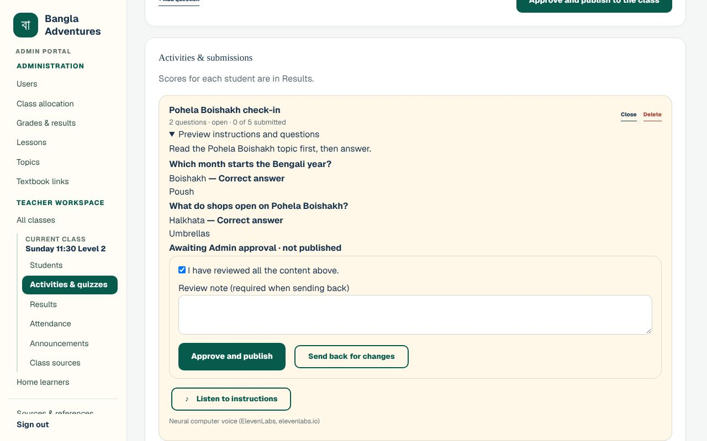

For links, select **Class sources** and follow the same steps: tick
**I have reviewed all the content above.** and select **Approve and publish**.

To take back an approved activity or source, type a **Review note** and select
**Withdraw and request changes**. It then says **Changes requested · not published**, and
students and parents no longer see it.

An activity or link you add yourself is approved as you add it and says
**Approved by Admin · published** straight away. While approval for teachers' class
activities or class sources is switched off (see [Who needs approval](#who-needs-approval)),
a teacher's new activity, or new or edited link, is published as they save it and says
**Approved · published**, with no Administrator named. (An item you approved also shows
**Approved · published** once your account has been deleted, because it no longer names you.)
You can still send it back with **Withdraw and request changes**. A link you send back or
withdraw stays with you: the teacher's edit of it waits for your approval even while the switch
is off, and keeps your review note under it until you approve it or send it back again.

## Optional narration (computer voice)

Each class activity has a **Listen to instructions** button. It reads the instructions aloud
in a computer voice. This narration is optional. The line under the button names the voice:
"Neural computer voice (ElevenLabs, elevenlabs.io)" when a key is set or after ElevenLabs audio
has played; otherwise *"This device's voice"* once the reader's device has read the text, and
no line before that.

- New narration needs the **school's own ElevenLabs account and key**. The client buys an
  ElevenLabs plan (or gets nonprofit credits) and passes the key privately to whoever runs
  the server. See [Narration key](../VPS_DEPLOYMENT.md#narration-key).
- Never paste a key into a page, an email or a chat. It belongs only on the server.
- Until a key is added, the site works normally with its existing recorded audio and
  narration already saved. For other text, each reader's own device reads it aloud with its
  own voice for that language (a Bangla voice for Bangla, never an English one), and the note
  under the button says *"This device's voice"*. A device with no such voice shows a calm note,
  *"Audio isn't available for this text on this device yet. Read it on the screen
  instead."*, not an error. Once the key is added, every Listen uses the ElevenLabs voice again.
- Your preview of an activity that is waiting for approval, or was sent back, is never sent to
  ElevenLabs, with or without a key. With no audio saved for it, **Listen to instructions**
  reads it with your device's own voice, or shows the same calm note.

## Recent changes (the record of actions)

At the bottom of the **Users** page, select **Recent changes** to open the list of the 15
most recent actions. Each entry says what happened (for example "Parent linked",
"Added to a class", "Quiz answers reset", "Textbook hidden", "Topic withdrawn from students",
"Approval setting changed" or "Class deleted"), which account or item it was about, and when.
Your own topics and recordings appear as "Topic approved" and "Lesson recording approved"
under your name. A teacher's work published while its approval was switched off appears under
the teacher's name as "Topic published at once (approval was off)", "Class activity published
at once (approval was off)" or "Class source published at once (approval was off)".

Each entry also says who made the change: **By:** with the account's name, **By: Server
operator** for a command run on the server, or **By: Deleted account** for an account deleted
since. A deleted class or account is still named, with the name it had when the change was
made. Class events include classes created, activities added, reviewed, opened and closed,
announcements posted and attendance saved; account events include passwords recovered,
recovery codes replaced, signing out everywhere and accounts deleted. Older actions drop off
the list as new ones are added.

## Other pages in your menu

**Home learners** (under **Teacher workspace**) is a separate space for guiding a learner
without giving them an account. You add a profile with a **Display name** and select
**Create learner profile**. The profile then shows the learner's progress and an
**Assign next** section for choosing lessons. No child email, birthday, photo or school is
asked for. Most Administrators will not need it.

## Looking after your account

Select **Account & recovery** in the menu.

- **Change password:** type your **Current password** and a **New password** (at least 10
  characters), then select **Change password**. The message is *"Password changed. Any other
  signed-in devices have been signed out."*
- **Sign out everywhere:** ends every session on every device at once, including this one,
  and takes you back to the home page. Use it if a shared or public computer may still be
  signed in.
- **Recovery codes:** type your **Current password** and select
  **Generate new recovery codes**. Eight new codes appear once, with
  *"Save these now — they are shown only once."* Save them; every older code stops working.
- **Delete account** is also on this page, but an Administrator account cannot be deleted
  there. If you try, the page says *"Ask another administrator to change your role before
  deleting this account."*

You cannot change your own role or suspend your own account. Ask another Administrator if
that is needed.

## Switching language

The portal works in English and Bangla.

- In the portal, select **বাংলা** at the top right. The menu, headings and buttons change
  to Bangla, and the button changes to **English** so you can switch back.
- On the sign-in page, select **বাংলায় দেখুন** (it then shows **View in English**).

A message that was already on the screen before you switched may stay in the first
language until you do something else.

## Privacy and safety

**What you can see**

- Every adult account's name, email, role and status, and every student's name and
  username.
- Every class, with its students, activities, results, attendance, announcements and class
  sources.

**What you cannot see or do**

- You cannot see anyone's password. A temporary password is shown **once only**, when you
  create an account or reset a password, and nothing is sent by email.
- You cannot change your own role or suspend your own account.
- The **Users** page never deletes an account for good. Suspending keeps the person's
  learning records.

**Keeping things safe**

- Approve only people you can identify. Link a parent to a child only after you have
  checked that the adult is allowed to see that child's records.
- Hand each family only their own sign-in page, privately. Keep printed sheets away from
  other families, and shred spare copies.
- Sign out on shared computers.
- Keep your recovery codes private and somewhere safe.

**What the platform stores**

Grown-up accounts hold only an email, a display name and a securely stored password.
Student accounts need no child email or birth date. Parents who are linked to a child can
see that child's classes, activities and results, but cannot change them, and cannot see
other families' children.

Your actions on the **Users** page show *"The action has been recorded."* and appear in
**Recent changes**.

## Troubleshooting

| What you see or what happens | What it means | What to do |
| --- | --- | --- |
| *"Your account is waiting for an administrator to approve it. You can sign in once it is approved."* | The person created their own account and is in your **Waiting for approval** box. | Approve them on the **Users** page. |
| *"An administrator has not approved this account. Please contact your administrator."* | The account was declined. | If that was a mistake, filter the accounts list by **Declined** and select **Approve** (for a teacher request, **Approve as teacher**). |
| *"That email and password do not match."* | The email or password is wrong, or the account was deleted. | Check for typing mistakes and try again. For a forgotten password, see [Resetting a password](#resetting-a-password). |
| *"This account is suspended. Please contact the administrator."* (a student sees *"This account is suspended. Ask a grown-up to contact the administrator."*) | The password was right, but the account is suspended. | If they should have access again, find their row (it says **Suspended**) and select **Reactivate**. |
| *"Too many attempts. Please wait 15 minutes and try again."* (the time can differ) | Too many wrong passwords or recovery codes, or many sign-ups from one connection (30 an hour). | Wait for the time it says, or create the accounts yourself. |
| *"This account does not have administrator access. Sign in with your administrator account."* | You used the Administrator sign-in page with a parent or teacher account. | Sign in with your Administrator account. |
| A page says **Administrator access required** | You are signed in with an account that is not an Administrator, for example a teacher account. | Select **Sign in as administrator** and use your Administrator account. |
| *"There are no approved teachers yet. Approve a teacher account in Users first."* | You can only make a class for an approved teacher. | Approve their teacher request on the **Users** page, or create their account with **Approved teacher**. |
| The approve button is greyed out | Approval buttons stay greyed out until you have done the check. Sending something back or withdrawing it needs a note first. | Tick the review box for a topic or class item, open all 7 parts of a lesson, or play a recording to the end and then tick the box. To send back or withdraw, type the note. |
| A family upload says *"Nothing was created. Fix the rows listed and upload the file again."* | Nothing was created. | Correct each line listed (for example an email address without "@") and upload the whole file again. |
| You lost a sign-in sheet before printing it | The passwords cannot be shown again. | Select **Reset password** for each person to make a new temporary password. |
| A Listen button says *"Audio isn't available for this text on this device yet."*, or reads with *"This device's voice"* | No ElevenLabs key has been added on the server, so the reader's device reads the text itself, when it has a voice for that language. Or, with or without a key, it is your preview of an activity that is waiting for approval or was sent back: its preview is never sent to ElevenLabs, so your device reads it. | Nothing is broken. To use the ElevenLabs voice, see [Optional narration](#optional-narration-computer-voice). For a preview, approve the activity and Listen uses the ElevenLabs voice if a key is set. |
| Students cannot see a topic, lesson, video or activity | It is probably still waiting for approval, or it was withdrawn. | Check its status in **Topics**, **Lessons** (including **Video check**) or the class's **Activities & quizzes**. |

## Getting help

- **For help with the website:** ask another Administrator at your school.
- **For server problems** (the website is down, you are the only Administrator and are
  locked out, or narration needs a key): contact the person who runs your school's server.
- Teachers, parents and students should come to you, their school's Administrator, for new
  accounts, password resets and linking parents to children. Their guides are the
  [Teacher guide](teacher.md), the [Parent guide](parent.md) and the
  [Student guide](student.md); the [user guides index](README.md) lists them all.
