# Bangla Adventures — Parent guide

This guide is for parents and carers whose children learn Bangla, and the culture, history
and literature of Bangladesh, at a community Bangla school that uses Bangla Adventures. It is
also for the school's office staff and for any adult helping a family get started. With a
parent account you can see your own children's classes, activity results and attendance, open
the links their teacher shares with the class, and read announcements that teachers send to
parents. Your view is read-only: you can look, but you cannot change schoolwork, results or
attendance. You only ever see the children the school's Administrator has linked to your
account.

The pictures in this guide use made-up people, such as the parent Sadia Khan, her children Maya and
Arif, and their teacher Ms Rahman. Passwords, recovery codes and web addresses are blurred.

## Contents

1. [Before you start](#before-you-start)
2. [Signing in](#signing-in)
3. [Getting linked to your child](#getting-linked-to-your-child)
4. [Seeing your children's learning](#seeing-your-childrens-learning)
5. [Reading results and attendance](#reading-results-and-attendance)
6. [Opening class sources](#opening-class-sources)
7. [Reading announcements](#reading-announcements)
8. [Sources & references](#sources--references)
9. [Looking after your account](#looking-after-your-account)
10. [Using a phone](#using-a-phone)
11. [If you also teach at the school](#if-you-also-teach-at-the-school)
12. [Switching language](#switching-language)
13. [Privacy and safety](#privacy-and-safety)
14. [Troubleshooting](#troubleshooting)
15. [Getting help](#getting-help)

## Before you start

You need:

- A computer, tablet or phone with a web browser and an internet connection.
- Your school's Bangla Adventures web address. Ask the school if you do not have it. It is
  also printed on the family sign-in sheet (see below).
- A parent account. There are two ways to get one, shown below.
- Your child needs their own student account. You do not need to know its password. Only the
  school's Administrator can link your account to your child. The [Student guide](student.md)
  explains how your child signs in.

### Way 1: create your own account

1. Open the school's Bangla Adventures web address. You see the welcome page.
2. Scroll down to **How will you join us?** and find the **I'm a parent** card.
3. Select **Create parent account**.

   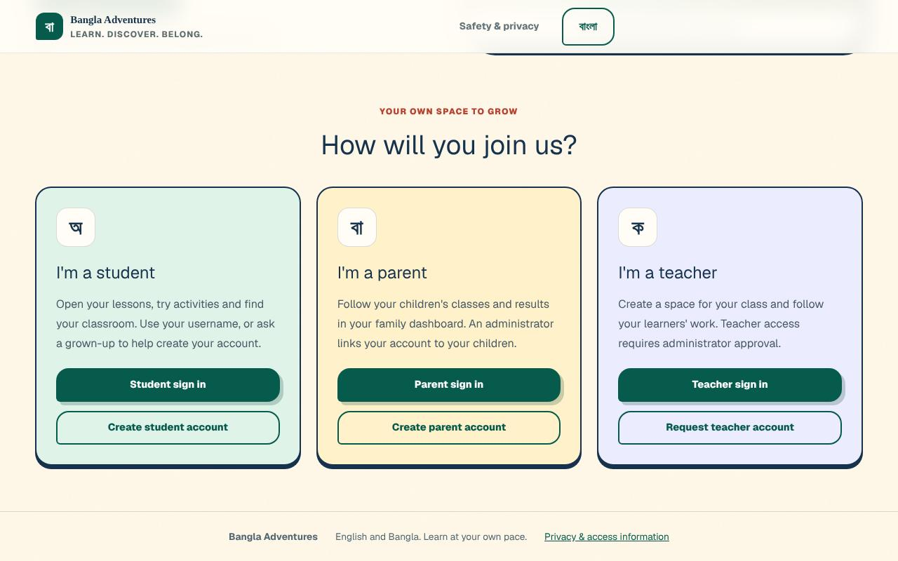

4. The **Create account** tab is open. **Account type** already says **Parent or carer**.
   Leave it like that.
5. In **Your name**, type your name as the school knows it.
6. In **Email**, type your email address.
7. In **Password**, type a password of at least 10 characters.
8. Select **Create account**.

   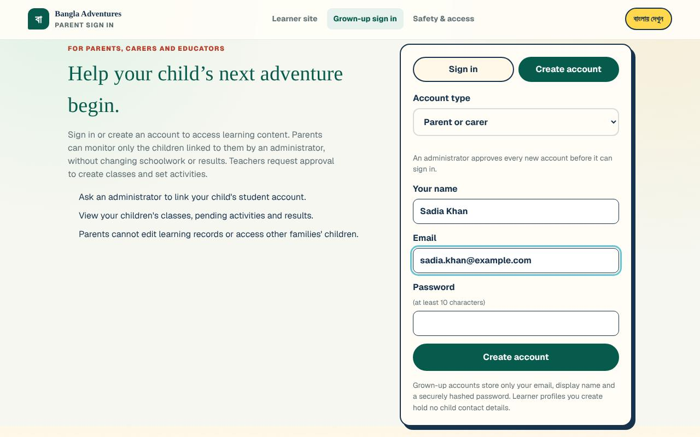

**What you'll see:** the heading **Account created — waiting for approval**, and under it
**Save your recovery codes** with a list of eight one-time codes.

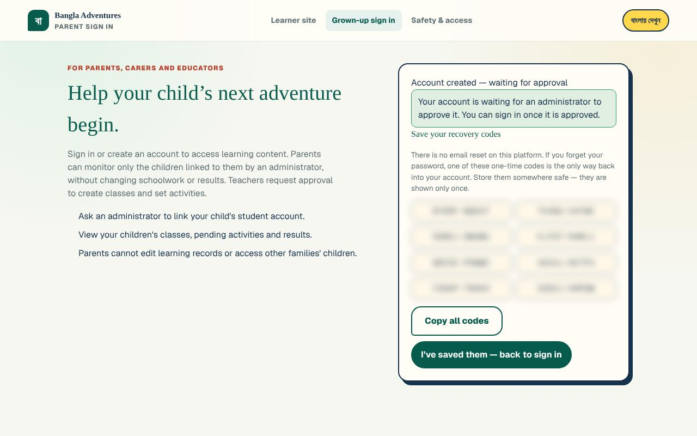

9. Save the codes now. They are shown only once. Select **Copy all codes** (the button
   changes to **Copied ✓**) and paste them somewhere safe, or write them down and keep the
   paper private. There is no email reset on this platform: if you forget your password, one
   of these codes is the only way back in.
10. Select **I’ve saved them — back to sign in**. The **Sign in** tab opens, with your email
    already filled in.
11. Tell the school's Administrator that you have created an account, and which email you
    used.

An Administrator approves every new account before it can sign in (see
[Approving or declining new accounts](administrator.md#approving-or-declining-new-accounts)).
Until then, signing in shows: *"Your account is waiting for an administrator to approve it.
You can sign in once it is approved."*

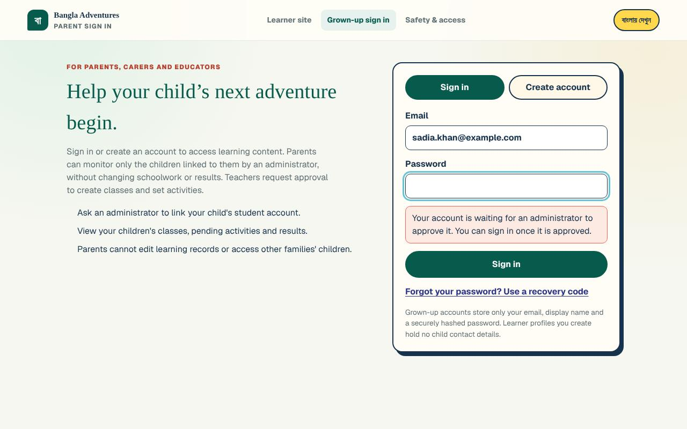

If you try to create a second account with the same email, you see *"An account with this
email already exists. Sign in instead."*

### Way 2: the school creates your account for you

The Administrator can create parent and student accounts together from one family list (see
[Importing families from a CSV file](administrator.md#importing-families-from-a-csv-file)).
Nothing is sent by email. Instead, the school gives you a printed **family sign-in sheet**,
one page per family. It shows:

- **Parent / অভিভাবক**: your name.
- **E-mail / ইমেইল**: the email address your account uses. You sign in with this.
- **Temporary password / অস্থায়ী পাসওয়ার্ড**: a one-time password for your first sign-in.
  If you already had an approved parent account with the same name and email, it says
  *"Existing account, password unchanged"*. Keep using your own password.
- **Sign in at / সাইন ইনের ঠিকানা**: the web address for parents.
- A table with each child's name, **Username** and **Temporary password**. Children sign in
  with their username at the student address printed under the table.

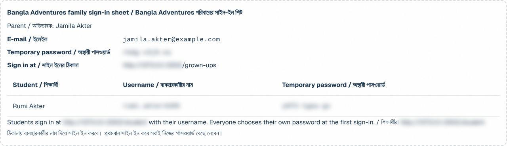

The Administrator can also make just your parent account on its own (see
[Creating an account](administrator.md#creating-an-account)). You then get a sheet headed
**Bangla Adventures sign-in details**, with your **Name**, **Email**, **Temporary password**,
the **Sign in at** address and eight **Recovery codes**. Those codes stop working when you
choose your own password, and you get a new set then.

Keep any sheet private. Anyone holding it can sign in as you until you choose your own
password. At your first sign-in you will be asked to choose a new password (see
[First sign-in with a temporary password](#first-sign-in-with-a-temporary-password)).

## Signing in

1. Open the school's Bangla Adventures web address.
2. On the **I'm a parent** card, select **Parent sign in**.
3. Make sure the **Sign in** tab is selected.
4. Type your **Email** and **Password**.
5. Select **Sign in**.

**What you'll see:** your children's page, **My children**. The menu on the left has
**My children**, **Sources & references**, **Account & recovery** and, at the bottom,
**Sign out**. The page says **Parent portal** at the top of the menu.

If you are still signed in from last time, opening the web address takes you straight to
**My children**. If you open a parent page while signed out, you are taken to the sign-in
page first and then back to that page.

### First sign-in with a temporary password

If the school gave you a temporary password (on a family sign-in sheet, on a sign-in details
sheet, or after a password reset), you must replace it before you can use anything else.

1. Sign in with your email and the temporary password, as above.
2. The **Choose your own password** page opens. It shows **Signed in as** with your name
   and email. Check they are yours.

   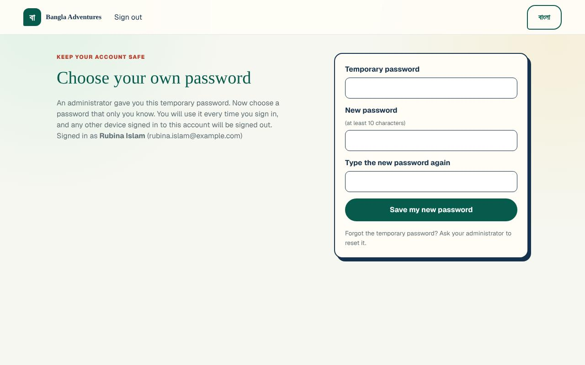

3. In **Temporary password**, type the temporary password again.
4. In **New password**, type a new password of at least 10 characters.
5. In **Type the new password again**, type the same new password.
6. Select **Save my new password**.
7. The heading changes to **Your password is changed** and you see
   **Save your new recovery codes**. Save them now (**Copy all codes**, or write them down).
   They are shown only once.
8. Select **I’ve saved them — continue**. Your children's page opens.

Every other page sends you back to this page until you have chosen your own password.

### Signing out

- Select **Sign out** at the bottom of the menu. On a phone, open **Menu** first.
- You go back to the sign-in page.
- Always sign out on a shared or public computer.

To sign out on every device at once, see [Sign out everywhere](#sign-out-everywhere).

On a family computer, your child can sign in to their own student account from the learning
pages: the Bangla lessons page keeps its **Student login** button at the top while you are
signed in. Signing in as the student signs your grown-up account out on that browser.

### If you forget your password

You need your email address and one unused recovery code.

1. On the sign-in page, select **Forgot your password? Use a recovery code**.
2. In **Email**, type your email address.
3. In **Recovery code**, type one code from your saved list (it looks like `XXXXX-XXXXX`).
4. In **New password**, type a new password of at least 10 characters.
5. Select **Reset password**.

**What you'll see:** you are signed in straight away and your children's page opens. As the
form explains, the code is then used up and every signed-in device is signed out. Each code
works only once, so cross it off your list.

To go back without resetting, select **Back to sign in**.

**No codes left?** Ask the school's Administrator to reset your password (see
[Resetting a password](administrator.md#resetting-a-password)). They give you a new
temporary password privately. Your old password stops working, and at your next sign-in you
choose your own password, as in
[First sign-in with a temporary password](#first-sign-in-with-a-temporary-password). If you
forget the temporary password itself, ask the Administrator again.

## Getting linked to your child

Your account shows nothing about a child until the school's Administrator links the two
accounts. Knowing a child's name or username is not enough. Until a link is made, your page
is headed **Learning records** and shows **No children linked yet**.

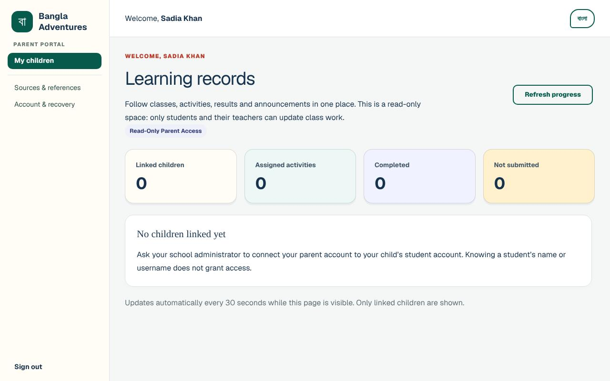

The Administrator links you in one of two ways:

- **Family access.** On the Administrator's **Users** page, they find your child, select
  **Family access**, type your account email in **Parent account email**, tick
  **I verified this adult is authorized to view this student's learning records.** and
  select **Link parent** (see
  [Linking a parent to a student](administrator.md#linking-a-parent-to-a-student)).
- **Import families (CSV).** They upload one list with the columns **student name**,
  **parent name** and **parent email**. Brothers and sisters share one parent email. If your
  email already belongs to your approved parent account with the same name, your children are
  linked to that account and your password stays the same. Otherwise a new parent account is
  created for you and you receive a family sign-in sheet.

To help the Administrator:

1. Create your account first (or tell them you have one) and wait for approval.
2. Give them the exact name and email address you used for your account.
3. Give them each child's full name, and their username if they already have one.

Once the link is made, select **Refresh progress** on your page, or wait. The page updates by
itself every 30 seconds while it is open. The heading changes to **Your child's learning**
(one child) or **Your children's learning** (two or more).

## Seeing your children's learning

Select **My children** in the menu.

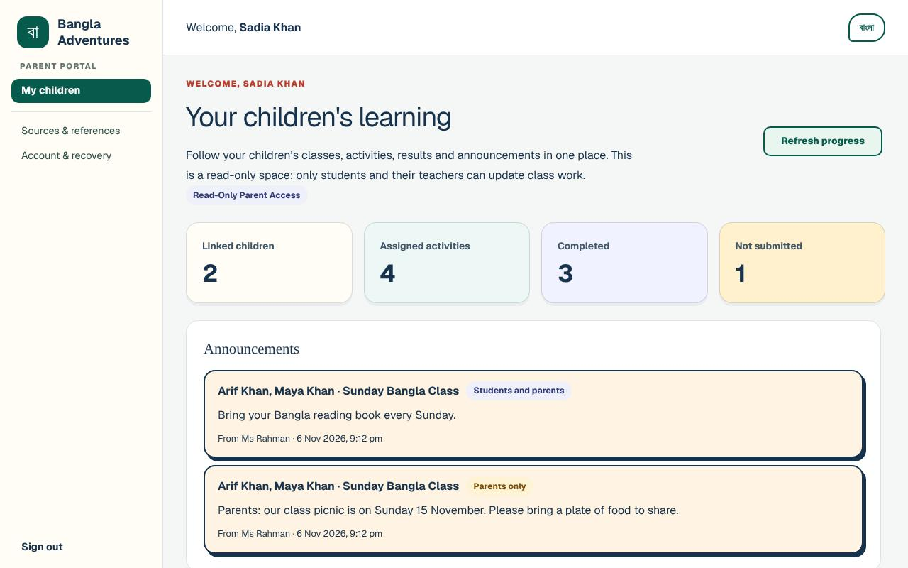

**What you'll see, from the top:**

- **Welcome**, your name, and the heading **Your child's learning** or
  **Your children's learning**.
- A note that this is a read-only space, and the badge **Read-Only Parent Access**.
- **Refresh progress**: loads the latest information now.
- Four boxes, added up for all your linked children:
  - **Linked children**: how many children are linked to your account.
  - **Assigned activities**: how many activities their classes have been given.
  - **Completed**: how many of those your children have submitted.
  - **Not submitted**: how many have not been submitted. This includes any the teacher has
    already closed.
- **Announcements** from your children's teachers (see
  [Reading announcements](#reading-announcements)).
- One panel for each child, with their classes, activities and results.
- If a linked child's student account is suspended or not yet approved, that child has no
  panel and is not counted. Instead a box says *"A linked child's account is not active"* and
  *"An account that is suspended or not yet approved is not shown here, and its records come
  back when it is active again. Please contact the administrator."*
- At the bottom: *"Updates automatically every 30 seconds while this page is visible. Only
  linked children are shown."*

## Reading results and attendance

Scroll down to your child's panel.

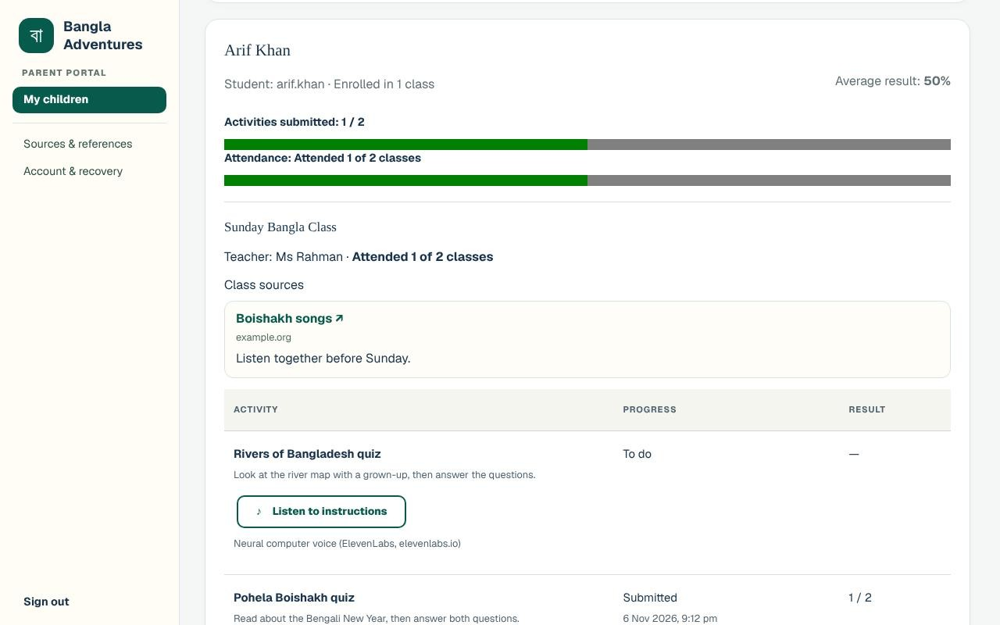

**At the top of each child's panel:**

- Your child's name, then **Student:** with their username, and how many classes they are
  enrolled in (for example **Enrolled in 1 class**).
- **Average result**: the average score of the activities your child has submitted. It says
  **Not graded yet** until they submit one.
- **Activities submitted**, for example **1 / 2**, with a bar.
- **Attendance**, for example **Attended 1 of 2 classes**, with a bar. Before the teacher
  takes attendance it says **No attendance taken yet**.

If your child is not in a class yet, the panel says *"No class enrolments yet. Learning
records will appear after your child joins a class."*

**For each class:**

- The class name, then **Teacher:** with the teacher's name, and the attendance for that
  class.
- **Class sources**, if the teacher has shared any (see
  [Opening class sources](#opening-class-sources)).
- A table with three columns:
  - **Activity**: the activity's name and the teacher's instructions.
  - **Progress**: **To do** (not submitted yet), **Submitted** (with the date and time), or
    **Closed · not submitted** (the teacher closed it before your child submitted it).
  - **Result**: the score, for example **2 / 2**, or **—** when there is no score yet.

Activities that are still open also have a **Listen to instructions** button, with the note
*Neural computer voice (ElevenLabs, elevenlabs.io)* under it. Selecting it asks a computer
voice to read the instructions aloud. If the button changes to **Try again**, the voice could
not be prepared, and a short message says why:

- *"Could not prepare the voice. Check your connection and try again."*: usually your
  internet connection dropped. Check it and select **Try again**.
- *"New narration is not configured. Saved audio is still available."*: the school has not
  switched the computer voice on. Trying again will not help.

Either way, the instructions are still there to read on the screen.

You cannot change anything here. Only your child and their teacher update class work. New
activities appear only after the school's Administrator has approved them.

## Opening class sources

Teachers can share useful links with a class, such as songs, stories or reading (see
[Adding class sources](teacher.md#adding-class-sources) in the Teacher guide). An
Administrator approves each link before families see it.

1. In your child's panel, find **Class sources** under the class name.
2. Each source shows its title with a small arrow (↗), the name of the website it is on (for
   example `example.org`), and any note from the teacher.
3. Select the title. The link opens in a new browser tab, on another website outside Bangla
   Adventures. Your children's page stays open in the first tab.

Check a website yourself before your child uses it.

## Reading announcements

Announcements are short messages from your children's teachers (see
[Posting announcements](teacher.md#posting-announcements) in the Teacher guide). They are in
the **Announcements** box near the top of **My children**, newest first.

Each announcement shows:

- Your child's name (or children's names) and the class, for example
  **Arif Khan, Maya Khan · Sunday Bangla Class**.
- Who it is for: **Parents only** or **Students and parents**.
- The message.
- **From** and the teacher's name, with the date and time it was posted.

Teachers can also post messages for students only. Those do not appear on your page.

You cannot reply to an announcement on Bangla Adventures. To answer a teacher, use the
school's usual way of contacting them.

## Sources & references

Select **Sources & references** in the menu. This page lists the textbooks the platform's
culture, history and literature topics draw on, from the National Curriculum and Textbook
Board, Bangladesh. Each book has links such as **Official NCTB page ↗**, which open the
NCTB website. Your children's class links are not on this page; they are in each child's panel
on **My children**.

## Looking after your account

Select **Account & recovery** in the menu. The page is headed **Your data, in your hands.**
and shows **Signed in as** with your name and email.

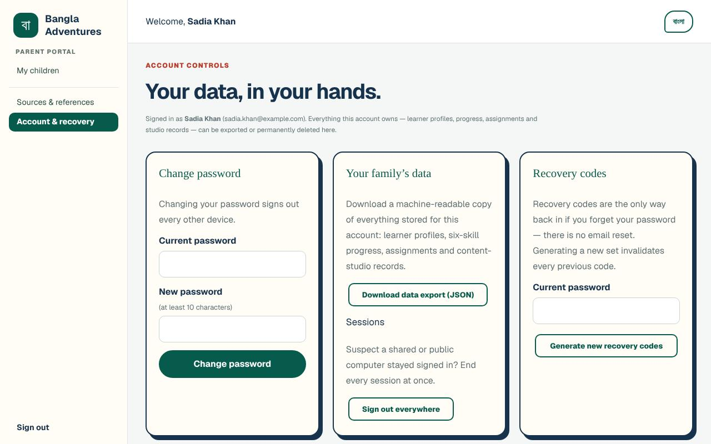

### Change your password

1. Under **Change password**, type your **Current password**.
2. Type a **New password** of at least 10 characters.
3. Select **Change password**.

**What you'll see:** *"Password changed. Any other signed-in devices have been signed out."*
You stay signed in on this device. If the current password is wrong, you see
*"Your current password is incorrect."*

### Get new recovery codes

Do this if you have used most of your codes, or think someone else has seen them.

1. Under **Recovery codes**, type your **Current password**.
2. Select **Generate new recovery codes**.
3. Save the eight new codes. The page says *"Save these now — they are shown only once."*

Every older code stops working.

### Download your account's data

Under **Your data**, select **Download data export (JSON)**. Your browser saves a file
called `bangla-adventures-export.json`. It holds what is stored for your own account: your name
and email, the names of the children an administrator linked to you, any home learner profiles
with their progress, and a history of the changes made to your account. It does not contain your
children's class results or attendance; those stay with the school.

### Sign out everywhere

Under **Sessions**, select **Sign out everywhere**. This signs your account out on every
device, including this one, and takes you to the welcome page. Use it if you think you stayed
signed in on a shared or public computer.

### Delete your account

This cannot be undone.

1. Scroll down to **Delete account**.
2. Type your **Current password**.
3. In the box under **Type DELETE to confirm**, type `DELETE`.
4. Select **Permanently delete account**.

**What you'll see:** the welcome page. Your parent account is removed and its links to your
children are gone. Your children's student accounts are not deleted. To see their learning
again, you would need a new account and a new link from the Administrator.

## Using a phone

Everything works the same on a phone. The menu is folded away to save space.

1. Select **Menu** at the top left to open it.
2. Select the page you want. The menu closes by itself.

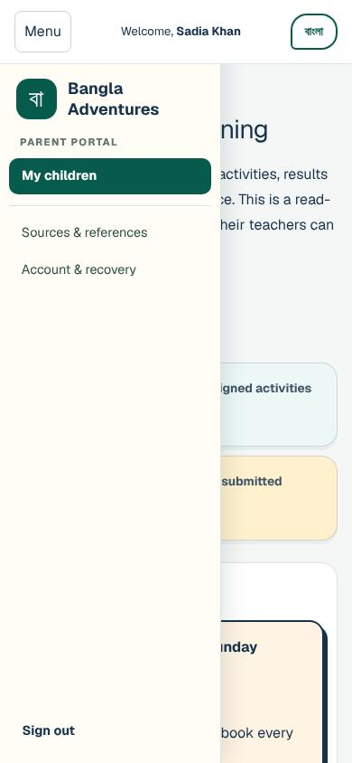

The language button (**বাংলা** or **English**) is at the top right.

## If you also teach at the school

Please talk to the school's Administrator first. One account is either a parent account or a
teacher account, and asking for teacher access changes your parent account (see below).

To ask for teacher access with your parent account:

1. Select **Sign out** in the menu. The sign-in page opens.
2. Select **Bangla Adventures** at the top left of the sign-in page. The welcome page opens.
3. On the **I'm a teacher** card, select **Teacher sign in**.
4. Sign in with your parent **Email** and **Password**.
5. You see **Your next chapter starts here**. Select **Request teacher access**.

The page then says **Your teacher request is with us**. Select **Go to family dashboard** to
go back. Your parent page keeps working while you wait.

When an Administrator approves the request, the same account becomes a teacher account. You
are signed out, and when you sign in again you arrive at the teacher workspace. The menu no
longer has **My children**, so you can no longer see your linked children's learning, and the
Administrator's **Family access** screen shows your link as
*"Access inactive because of account role or status."* If you want to keep the parent view,
ask the Administrator how they would like to set up your teacher account (for example, with a
different email address). The [Teacher guide](teacher.md) explains the teacher workspace.

## Switching language

Bangla Adventures works in English and Bangla.

- On the sign-in page, select **বাংলায় দেখুন** at the top right. To go back, select
  **View in English**.
- Once you are signed in, select **বাংলা** at the top right of the page. To go back, select
  **English**.

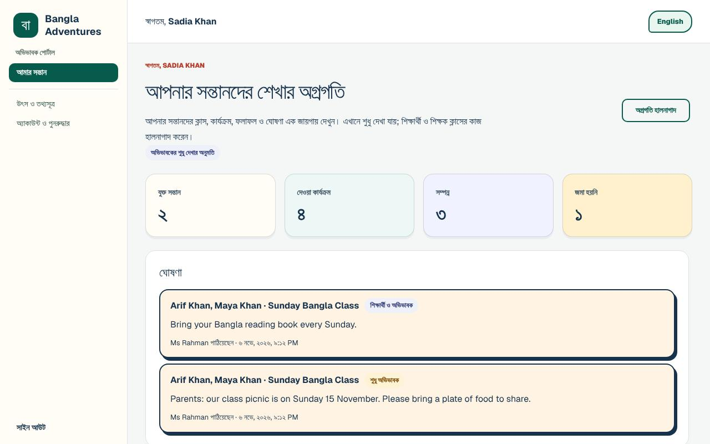

Menus, buttons, headings and labels change language, and numbers appear in Bangla digits.
Names, class names, activity titles and teachers' messages stay as the teacher wrote them. A
class source shows its Bangla title if the teacher gave one. Your browser remembers your
choice on this device, including the next time you sign in.

## Privacy and safety

**What you can see**

- Only the children an Administrator has linked to your account. Other children in the same
  class do not appear on your page.
- For each linked child: their classes, teachers' names, activities, results, attendance and
  approved class sources.
- Announcements for **Parents only** or **Students and parents** in your children's classes.

**What you cannot see or do**

- You cannot change schoolwork, results or attendance. There are no buttons for it.
- You cannot see other families' children, teachers' class lists or the Administrator's pages.
  If you open an Administrator page, it says **Administrator access required** and that your
  account cannot manage other users. Select **Back to my dashboard** to return to
  **My children**.
- You do not see announcements meant for students only.
- You do not see activities or class sources that are still waiting for the Administrator's
  approval.

**Keeping things safe**

- The sign-in page says that grown-up accounts store only your email, display name and a
  securely hashed password.
- Nothing is sent by email. The school hands out family sign-in sheets in person. Keep yours
  private, and give a child's details only to that child.
- Keep your password and recovery codes to yourself. The Administrator can reset your password
  without knowing either of them.
- An Administrator links you only after checking you are allowed to see that child's records.
  They can remove a link at any time. That child then disappears from your page (if no
  children are left, it shows **No children linked yet**). The child's learning records are
  kept, and they show again if the link is made again.
- Sign out on shared computers, or use [Sign out everywhere](#sign-out-everywhere).

## Troubleshooting

| What you see or what happens | What it means | What to do |
| --- | --- | --- |
| *"Your account is waiting for an administrator to approve it. You can sign in once it is approved."* | Your account is new. | Ask the school's Administrator to approve it, then sign in again. |
| *"An administrator has not approved this account. Please contact your administrator."* | The Administrator declined the account. | Contact them. They can approve it later. |
| *"That email and password do not match."* | The email or password is wrong, or the account has been deleted. | Check the email address for typing mistakes, and check Caps Lock. If you forgot your password, use a recovery code. If you are sure your details are right, contact the Administrator. |
| *"This account is suspended. Please contact the administrator."* | Your password was right, but the Administrator has suspended the account. | Contact the Administrator. |
| *"Too many attempts. Please wait 15 minutes and try again."* when signing in or using a recovery code (the time can differ) | Too many wrong passwords or recovery codes in a row. | Wait for the time it says, then try again with the right password, or use a recovery code. |
| *"Too many attempts. Please wait 59 minutes and try again."* (or another time) when creating an account | Many accounts (30 in an hour) were created from the same internet connection, for example on the school Wi-Fi. | Try again after the time it says, or from a different connection (such as home or mobile data). Or ask the Administrator to create the account for you. |
| A child you expect is missing from **My children**, with *"A linked child's account is not active"* | That child's student account is suspended or waiting for approval. | Contact the Administrator. |
| *"An account with this email already exists. Sign in instead."* | You already have an account. | Use **Sign in**, or **Forgot your password? Use a recovery code**. |
| *"That email and recovery code do not match, or the code was already used."* | The email or the code is wrong, or the code was used before. Each code works once. | Check the email and the code. Try another unused code, or ask the Administrator to reset your password. |
| *"The two new passwords do not match."* | When choosing your own password, the two new password boxes are different. | Type exactly the same new password in both boxes. |
| *"Choose a new password that is different from the temporary one."* | The new password is the same as the temporary one. | Pick a new password that is not the temporary one. |
| *"Your current password is incorrect."* | On **Account & recovery**, the **Current password** box does not hold the password you sign in with now. On **Choose your own password**, the **Temporary password** box is wrong. | Type the password you sign in with now, or the temporary password exactly as it is on your sheet. |
| **No children linked yet** | The Administrator has not linked your account to your child yet. | Give them your account's name and email, and your child's name. |
| A child, activity or class link is missing | Only linked children are shown, a child appears in a class once the teacher adds them, and new activities and class sources appear after the Administrator approves them. | Select **Refresh progress**. If something is still missing, ask the teacher or the Administrator. |
| *"Could not prepare the voice. Check your connection and try again."* (on **Listen to instructions**) | The computer voice could not be prepared, usually because the connection dropped. | Check your connection and select **Try again**, or read the instructions on screen. If it keeps happening, tell the school. |
| *"New narration is not configured. Saved audio is still available."* (on **Listen to instructions**) | The school has not switched the computer voice on. | Read the instructions on screen instead. |
| You lost the temporary password, or the family sign-in sheet | It cannot be shown again. | Ask the Administrator to reset your password. You get a new temporary password and the old one stops working. |

## Getting help

- **Accounts, approval, linking to your child, passwords:** contact your school's
  Administrator. They approve accounts, link families and reset passwords.
- **Classwork, results, attendance or an announcement:** contact your child's teacher. Their
  name is shown next to each class.
- Never send your password or recovery codes to anyone, including school staff.
- The [user guides index](README.md) lists the guides for every role, including the
  [Student guide](student.md) for your child.
