# Bangla Adventures — Student guide

This guide is for students who use Bangla Adventures, and for the parent, carer or teacher
helping them. Most students are children, so we suggest a grown-up reads it first and sits
with the child the first few times. As a student you can sign in with your own username,
see your classes, activities, results and attendance in **My Learning**, read the topics your
school has approved and do their quizzes, read your class announcements and class sources,
try the Bangla lessons and other learning pages, and switch the screens between English and
Bangla.

The pictures in this guide use made-up people: a student called Maya, her teacher Ms Rahman
and a class called River Explorers. Your screens will show your own name, classes and topics.

## Contents

1. [Before you start](#before-you-start)
2. [Signing in](#signing-in)
3. [My Learning: your home page](#my-learning-your-home-page)
4. [Reading topics and doing their quizzes](#reading-topics-and-doing-their-quizzes)
5. [Class activities](#class-activities)
6. [My results](#my-results)
7. [Attendance](#attendance)
8. [Announcements](#announcements)
9. [Sources & references](#sources--references)
10. [Lessons and other learning pages](#lessons-and-other-learning-pages)
11. [Changing your password](#changing-your-password)
12. [Using a phone or tablet](#using-a-phone-or-tablet)
13. [Switching language](#switching-language)
14. [Privacy and safety](#privacy-and-safety)
15. [Troubleshooting](#troubleshooting)
16. [Getting help](#getting-help)

## Before you start

You need:

- **A device with a web browser** (a computer, tablet or phone) and an internet connection.
- **The web address of your school's Bangla Adventures site.** Your school gives you this.
- **A student account.** You do not need an email address, a birthday or a class code.

There are two ways to get an account.

**1. Your school makes it for you (the usual way).** Your teacher or the school's
Administrator gives you, or your grown-up, your sign-in details on paper. They show:

- your **Name**
- your **Username**
- a **Temporary password**
- the address of the student sign-in page

The paper can look one of two ways:

- From the Administrator, it is a sheet called **Bangla Adventures sign-in details**, with
  the address under **Sign in at**. It says: *"At the first sign-in you will be asked to
  choose your own password. Only you will know it."*
- From your teacher, it is a list called **Student sign-in sheet**. It says: *"Sign in at*
  (the address) *with your username and temporary password, then choose your own
  password."*

An account made this way works straight away. Keep the paper somewhere private until you
have chosen your own password.

**2. You create your own account** on the sign-in page, with a grown-up's help (see
[Creating your own account](#creating-your-own-account) below). An Administrator must
approve the account before you can sign in.

> **Tip for grown-ups:** the sign-in page says *"Ask a grown-up for help. Use a nickname; no
> child email or birthday is needed."* Teachers make accounts as described in
> [Adding students from a CSV class list](teacher.md#adding-students-from-a-csv-class-list),
> and Administrators as described in [Creating an account](administrator.md#creating-an-account).

## Signing in

1. Open your school's Bangla Adventures address in your browser. The welcome page opens.
   (Or type the sign-in address from your sign-in details. It opens the student sign-in page
   straight away, so you can go on to step 3.)
2. Scroll down to **How will you join us?** In the **I'm a student** box, select
   **Student sign in**.

   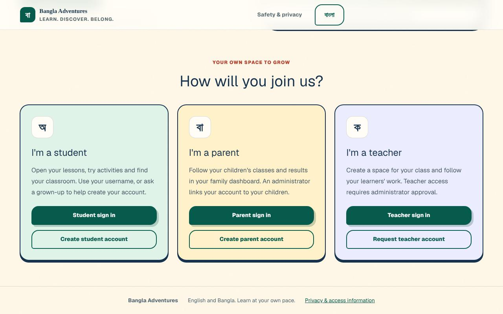

3. Type your **Username**. Capital letters do not matter in the username.
4. Type your **Password**. Capital letters *do* matter in the password.
5. Select **Sign in**.

   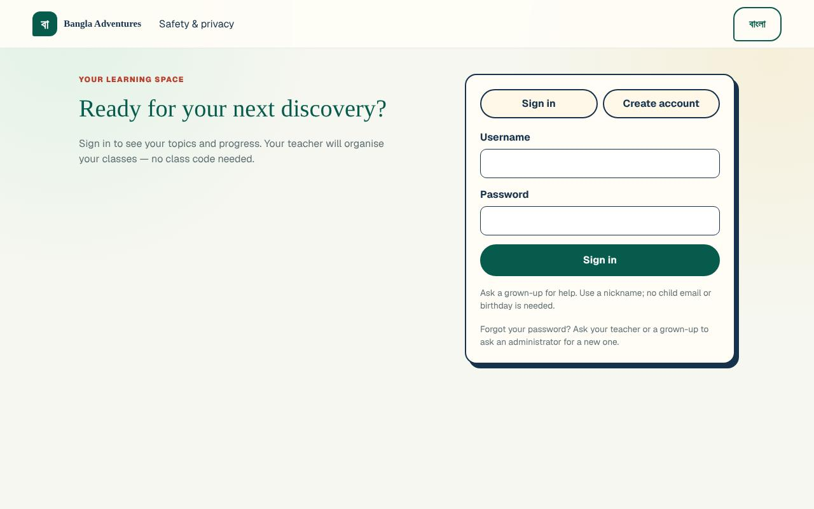

**What you'll see:** **My Learning** opens, with *Welcome,* and your name at the top. If you
signed in with a temporary password, the **Choose your own password** page opens first
(see below).

If you opened a learning page before you signed in, Bangla Adventures takes you to the
welcome page first. You can sign in from there.

### First sign-in: choosing your own password

If your school gave you a temporary password, you must choose your own password before you
can do anything else.

1. Sign in with your username and the temporary password.
2. The **Choose your own password** page opens. It says *Signed in as* with your name and
   username, so you can check it is your account.
3. In **Temporary password**, type the temporary password from your sheet.
4. In **New password**, type a new password of **at least 8 characters**. Choose one that only
   you (and your grown-up) know.
5. Type the same new password again in **Type the new password again**.
6. Select **Save my new password**.

   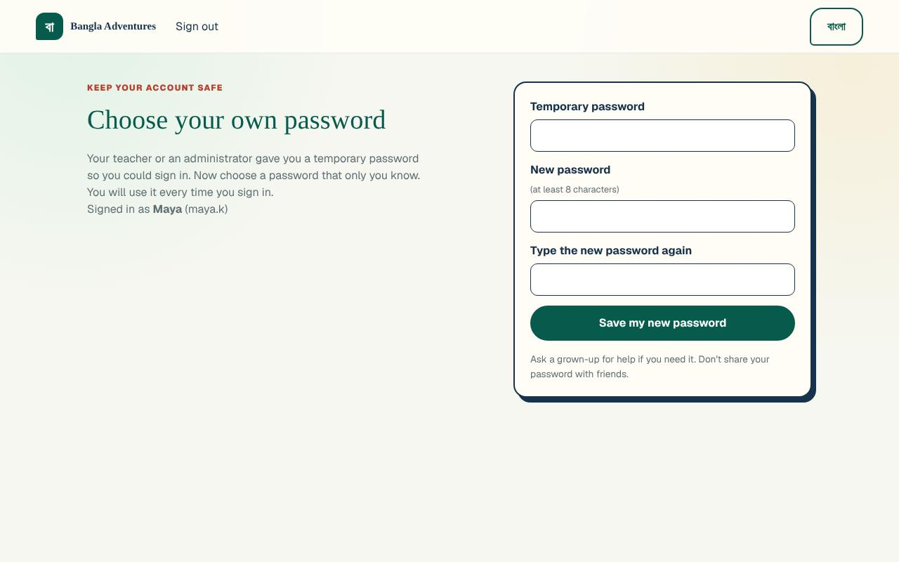

**What you'll see:** **My Learning** opens. From now on, sign in with your new password.
The temporary password no longer works.

- Until you finish this step, every other page brings you back to **Choose your own
  password**.
- The page has a **Sign out** link at the top if you need to stop and come back later.
- The note on the page says: *"Ask a grown-up for help if you need it. Don't share your
  password with friends."*

### Creating your own account

1. On the welcome page, select **Create student account**. (Or, on the student sign-in page,
   select the **Create account** tab.)
2. In **Student name**, type the name you want your teacher to see. A nickname is fine.
3. In **Username**, type a username. It must have at least 3 characters and can use
   letters, numbers, dots (.), dashes (-) or underscores (_). No spaces.
4. In **Password**, type a password of at least 8 characters.
5. Select **Create account**.

**What you'll see:** the message *"Your account is waiting for an administrator to approve
it. You can sign in once it is approved."* The form goes back to the **Sign in** tab, with
your username already filled in. You cannot sign in until the Administrator has
approved the account. Ask your teacher or grown-up to let the school know. (The
Administrator does this as described in
[Approving or declining new accounts](administrator.md#approving-or-declining-new-accounts).)

If someone already has that username, you will see *"That username is already taken."*
Choose a different one.

### Forgotten password

Students cannot reset their own password. The sign-in page says: *"Forgot your password?
Ask your teacher or a grown-up to ask an administrator for a new one."*

This is what happens:

1. The Administrator resets your password and gives you a new sign-in details sheet with a
   new **Temporary password** (see
   [Resetting a password](administrator.md#resetting-a-password) in the Administrator guide).
2. Your old password stops working straight away. If you were still signed in on a device,
   that device is signed out.
3. Sign in with your username and the new temporary password.
4. The **Choose your own password** page opens. Follow the steps in
   [First sign-in](#first-sign-in-choosing-your-own-password) again.

### Signing out

1. Select **Sign out** at the bottom of the menu on the left. (On a phone, open **Menu**
   first.)
2. The student sign-in page opens.

Always sign out on a shared or school computer. After you sign out, the learning pages ask
you to sign in again.

## My Learning: your home page

**My Learning** is the first page you see after signing in. The menu on the left has:

- **My Learning**
- **My activities**
- **My results**
- **Learning topics**
- **Sources & references**
- **Change password**
- **Sign out** (at the bottom)

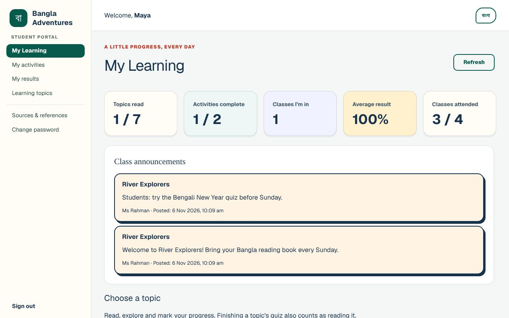

**What you'll see:**

- **Five progress boxes** across the top:

  | Box | What it shows |
  | --- | --- |
  | **Topics read** | How many approved topics you have read, out of all the approved topics, for example *1 / 7*. |
  | **Activities complete** | How many class activities you have submitted, out of the activities in your classes. |
  | **Classes I’m in** | How many classes you belong to. |
  | **Average result** | Your average score in class activities. It shows **—** until you finish an activity. |
  | **Classes attended** | How many class sessions you attended, out of the sessions your teacher recorded. It shows **—** until attendance is taken. |

- **Class announcements** from your teachers (see [Announcements](#announcements)).
- **Choose a topic**: the approved topics, grouped by category (see the next section).
- **More language activities** at the bottom, which opens the other learning pages.
- A **Refresh** button at the top right, which loads your newest classes, activities and
  results.

If you have not been put in a class yet, **Classes I’m in** shows *0* and the activities page
says *"Your teacher will add your class"*. You can still read topics while you wait.

## Reading topics and doing their quizzes

Topics are short readings about the history, culture and literature of Bangladesh. You only
see topics that have been approved. They are grouped by category, such
as **History & the national story**, **Our country — symbols, rivers & nature**,
**Culture, crafts & celebrations** and **Literature & stories**.

### Open a topic

1. On **My Learning**, scroll to **Choose a topic**. Or select **Learning topics** in the menu.
2. Select a topic card. Each card shows how many minutes it takes to read.
   - On **My Learning**, a card you have not read says **Start reading →**. A card you have
     read says **Read · revisit →**.
   - On the **Learning topics** page, a card you have read says **Read ✓**.
3. Read the topic. Some parts have a **Listen in Bangla** button, to hear that part read
   aloud (see [Troubleshooting](#troubleshooting) if it shows a message instead). Near the end
   there is a **Learning references** box with related NCTB textbooks and links such as
   **Class 3: Official NCTB page ↗**. These open the textbook board's website in a new tab.
4. To go back to the list, select **All topics** at the top of the topic.

### Mark a topic as read

There are two ways to count a topic as read:

- Select **Mark reading complete** after the reading (just above the quiz). The button
  changes to **Reading complete**.
- Or finish the topic's quiz. *"Finishing a topic's quiz also counts as reading it."*

Either way, **Topics read** goes up by one.

### Do the topic quiz

1. Scroll down to **📝 Show what you know**.
2. Select one answer for each question. Until every question has an answer, the button at the
   bottom says **Answer every question first**.
3. Select **Check my answers**.

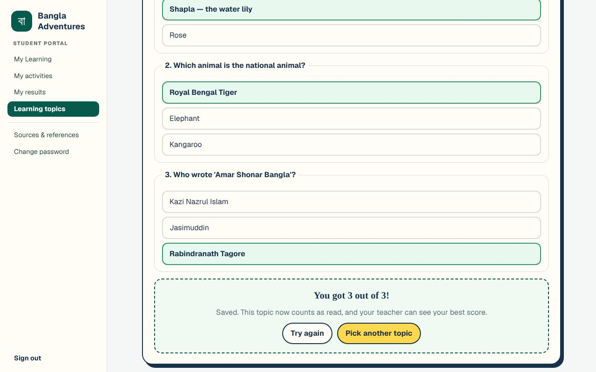

**What you'll see:**

- Your score, for example *"You got 3 out of 3!"*
- *"Saved. This topic now counts as read, and your teacher can see your best score."*
- **Try again** lets you do the quiz again. **Pick another topic** takes you back to the list.
- From then on, the quiz shows *"Your best so far:"* with your best score. On My Learning,
  the topic card shows **quiz best** and your best score.
- Only your first 3 tries at a topic's quiz each day can change your saved best score. After
  that the quiz is still marked, so you can keep practising, but it says *"This try was practice,
  so its score was not saved: only the first 3 tries at a quiz each day count. Your teacher sees
  your best saved score. Try again tomorrow to improve it."*

## Class activities

Your teacher can set activities for your class. An activity has instructions and
multiple-choice questions. A new activity appears once it is approved. Usually the school's
Administrator checks it first, but your school can let your teacher's activities appear as soon as
your teacher saves them.

### See your activities

Select **My activities** in the menu. Under **My class activities** there is a box for each of
your classes.

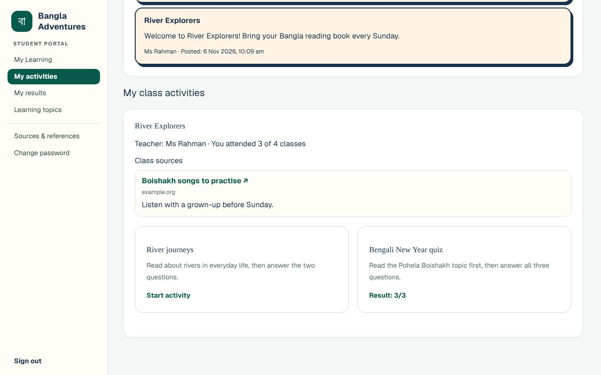

**What you'll see in each class box:**

- The class name.
- **Teacher:** and your teacher's name, then your attendance, for example *"You attended 3 of
  4 classes"*, or *"No attendance taken yet"*.
- **Class sources**: links your teacher has shared (see
  [Sources & references](#sources--references)).
- A card for each activity. The bottom of the card says:
  - **Start activity**: you have not done it yet.
  - **Result:** and your score, for example **Result: 3/3**: you have done it.
  - **Closed**: your teacher has closed it before you did it.
- You cannot open a closed activity. If you did it before your teacher closed it, the card
  still shows your **Result:**, but it no longer opens.
- If the class has no activities yet: *"Your teacher has not added activities yet."*

### Do an activity

1. Select the activity card (**Start activity**).
2. Read the instructions. If the activity is linked to a topic, select
   **Read the learning topic & references** to read it first.
3. For each question, select one answer. You must answer every question. If you miss one,
   the browser shows a message such as *"Please select one of these options."* beside it.
4. Select **Submit answers** at the bottom.

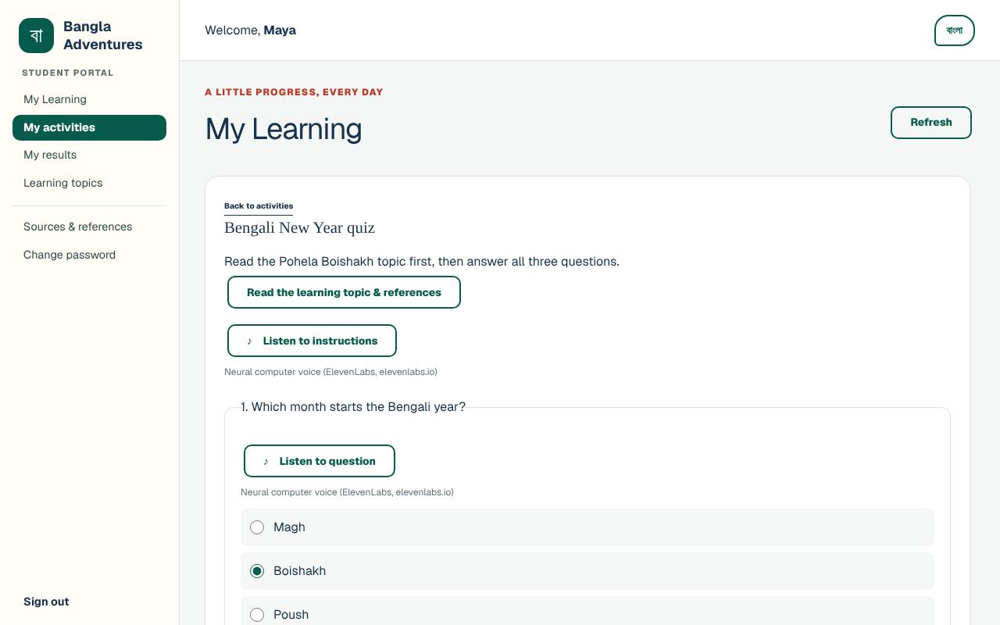

**What you'll see:** your score, for example *"You got 3 out of 3."*, and *"Your teacher can now
see your saved result."* Select **Back to activities** to return to the list.

After you submit, the page also lists your answers, for example *"Your answer: Poush · Correct
answer: Boishakh"* or *"Right: Halkhata"*.

**Each activity is handed in once.** The card then shows **Submitted** with your result. If you
open it again you see *"You handed this in on … Your first answers are kept, and your teacher can
see your result."* The page says *"Each activity is handed in once. Ask your teacher if you need
another try."* Only your teacher can let you try again.

The **Listen to instructions** and **Listen to question** buttons are for hearing the text read
aloud. See [Troubleshooting](#troubleshooting) if they show a message instead.

## My results

Select **My results** in the menu.

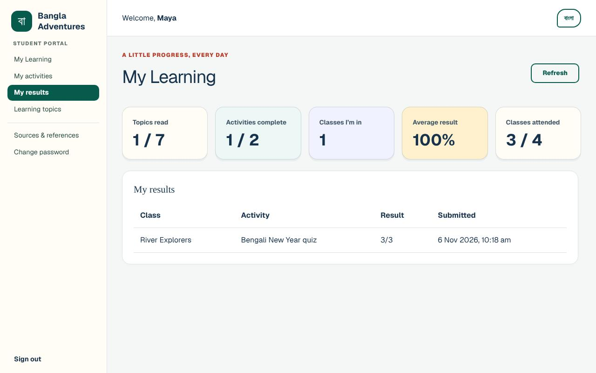

**What you'll see:** a table with one row for each activity you have submitted:

- **Class**: the class the activity belongs to
- **Activity**: the activity's name
- **Result**: your score, for example *3/3*
- **Submitted**: the date and time you submitted it

If you have not submitted anything yet, it says *"Complete a class activity to see your
results here."* Your topic quiz scores are not in this table. They show on the topic itself and
on its card.

## Attendance

Your teacher records who came to each class. You can see your attendance in two places:

- The **Classes attended** box on My Learning, for example *3 / 4*.
- Each class box in **My activities**, for example *"You attended 3 of 4 classes"*.

You can only look at your attendance. If you think it is wrong, tell your teacher.

## Announcements

Teachers post announcements to a class. On **My Learning** and **My activities**, the
**Class announcements** box shows them, newest first. Each one shows the class name, the
message, who posted it and when (*Posted:*).

**What you'll see:**

- Announcements for **everyone** in your classes, and announcements for **students only**.
- Announcements meant only for parents do not appear here.
- Only announcements from your own classes appear.
- With none yet: *"No class announcements yet. Notices from your allocated classes will appear
  here."*

## Sources & references

Select **Sources & references** in the menu.

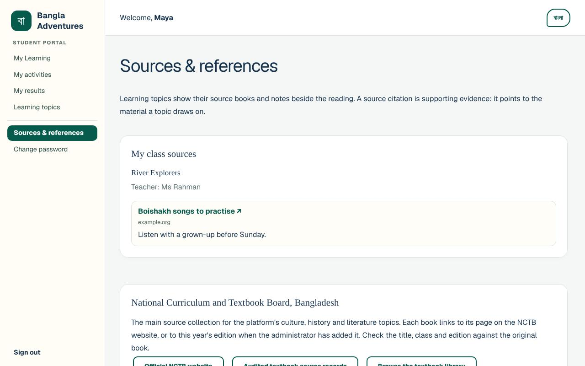

**What you'll see:**

- **My class sources**: for each of your classes, the links your teacher has shared, with
  any note, for example *"Listen with a grown-up before Sunday."* Only approved links are
  shown: usually the school's Administrator checks each link first, but your school can let your
  teacher's links appear as soon as your teacher saves them. The same links also appear in **My activities**.
- **National Curriculum and Textbook Board, Bangladesh**: the NCTB textbooks the topics come
  from, each with an **Official NCTB page ↗** link.

Links marked **↗** open another website in a new tab. A grown-up should check outside
websites with younger children.

## Lessons and other learning pages

At the bottom of My Learning, select **More language activities**. This opens a page called
**Discover Bangladesh — then keep exploring.** with cards for all the learning pages.

### The Bangla lessons

1. On the **More language activities** page, select **Guided language practice** (the button
   near the top), or the **The 18 lessons** card.
2. The lessons page opens at the top. Select **Lessons** in the bar at the top of the page to
   jump to **Your complete Bangla learning path**. (On a phone, scroll down to it.)
3. **Pre-A1** is chosen at first. Choose **All levels** to see every open lesson, or choose
   another level.
4. On a lesson, select **Open six-session lesson →**.
5. The lesson opens in its own window. Use the tabs **Overview**, **Listen**, **Read**,
   **Speak**, **Write**, **Watch** and **Mastery**, or the **Next →** and **← Previous**
   buttons at the bottom.
6. To close the lesson, select **×** in the top right corner (or press the Esc key). On the
   last tab, **Mastery**, the **Next →** button becomes **Close lesson ×**, which also closes
   it.

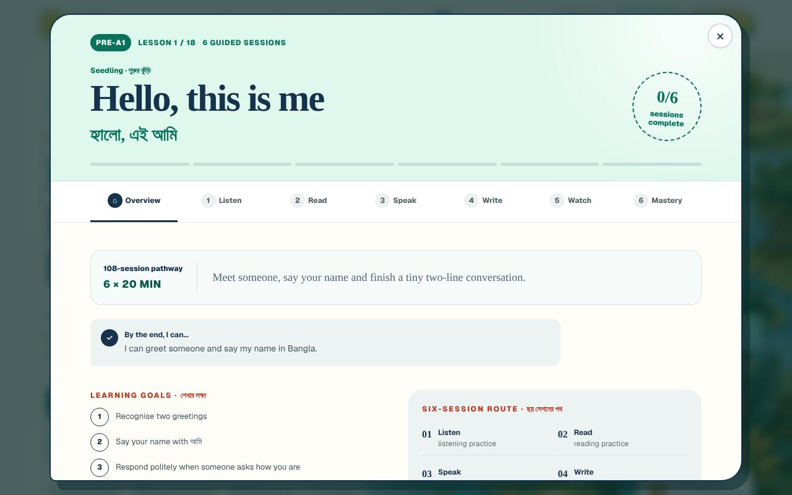

**What you'll see:**

- Only lessons the school's Administrator has approved are shown. If none are open at a
  level: *"No lessons are open at this level right now. Try another level."*
- In **Speak**, you can practise out loud and, if you want, record yourself with
  **● Allow mic & record**. The page says *"Your recording stays inside this tab"* and *"Audio
  is never uploaded and disappears when you close or delete it."*
- In **Watch**, if there is no approved video you will see *"This lesson's video is
  unavailable. Talk through the three prompts below with a grown-up instead."*
- To go back to My Learning from the lessons page, select **My Learning** at the top of the page.
  The **My classroom** card on the lessons page opens your class activities.

### Other learning pages

These cards are on the **More language activities** page. All of them need you to be signed
in.

| Card | What it is |
| --- | --- |
| **Classroom topics** | The same approved topics as **Learning topics**. |
| **NCTB textbook library** | The government textbooks behind the topics, with links. |
| **My classroom** | Opens your class activities on My Learning. You do not need a class code: your teacher adds you to classes. |
| **Poetry corner** | Well-known Bangla poems, exactly as the poets wrote them. |
| **Explore Bangladesh** | Quick facts, a history timeline, landmarks, festivals, food and music of Bangladesh. |
| **Story time** | Folk tales and stories, page by page in Bangla and English. |
| **Days & seasons** | The days of the week, the twelve Bengali months and the six seasons. |
| **More ways to learn** | Outside courses and tools. This page is **for grown-ups** to review first. |
| **The 18 lessons** | The Bangla lessons page, the same as the **Guided language practice** button. |
| **Bornomala — the alphabet** | All the Bangla letters. Tap a letter to hear it with its word. |
| **First phrases** | Everyday Bangla phrases for home and play. |
| **Numbers & counting** | Numbers one to one hundred, and a counting game. |
| **How Bangla works** | A friendly look-it-up guide to Bangla grammar. |
| **Word practice** | The lesson words, coming back for practice. The page says this word practice is *"kept on this device only"*, while the topics you read, your topic quiz scores and your class activity results are saved to your account. |
| **Printable worksheets** | A practice sheet to print for each available lesson. |
| **Make a certificate** | A printable certificate to celebrate a milestone. |

## Changing your password

You can change your password whenever you like.

1. Select **Change password** in the menu.
2. In **Current password**, type the password you use now.
3. In **New password**, type a new password of at least 8 characters.
4. Type it again in **Type the new password again**.
5. Select **Save my new password**.

**What you'll see:** My Learning opens again. The page warns: *"Any other device where you
are signed in will be signed out."* This really happens: if you are signed in on another
computer or tablet, it goes back to the sign-in page. To leave without changing anything,
select **Back to My Learning**.

## Using a phone or tablet

Bangla Adventures works on phones. On a small screen the menu is hidden.

1. Select **Menu** at the top left.
2. Select the page you want. The menu closes by itself.

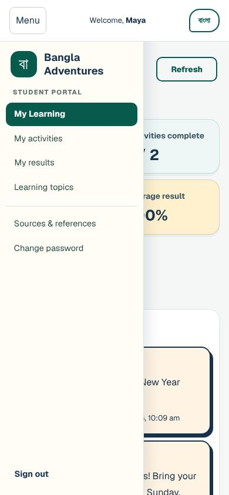

## Switching language

Every student page can be shown in English or Bangla.

1. Select **বাংলা** at the top right of the page.
2. The menus, buttons and topics switch to Bangla. The button now says **English**. Select
   **English** to switch back.

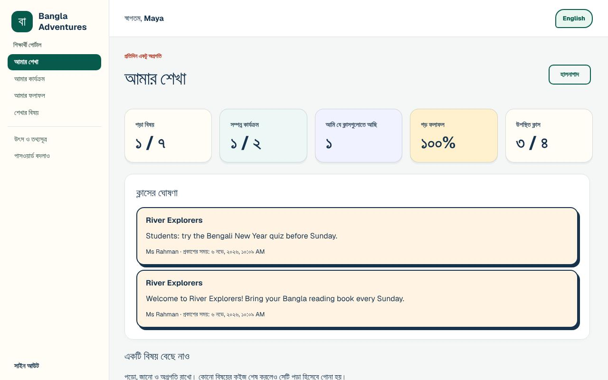

**What you'll see:**

- Your choice is remembered in this browser: other pages, and the sign-in page after you sign
  out, stay in the language you chose.
- Topics have their own Bangla version.
- Announcements and activities appear exactly as your teacher wrote them. They are not
  translated. A class source link shows its Bangla title, if your teacher gave it one, but its
  note stays as your teacher wrote it.
- The lessons page has its own **EN** and **বাংলা** switch at the top.

## Privacy and safety

**What a student needs to give**

A name (a nickname is fine), a username and a password. No email address, birthday or class
code is needed.

**What you can see**

- your own classes, with your teacher's name
- your own activity results, topic quiz scores and attendance
- announcements for everyone or for students in your classes
- activities and class sources in your classes, once they are approved
- topics once they are approved, and lessons the Administrator has approved

**What you cannot see**

- other students' results or attendance
- classes you are not in, and their announcements
- announcements meant only for parents
- activities, topics, lessons or links that are still waiting for approval
- teacher, Administrator and parent pages. If you open one, it asks for a grown-up to sign in.

**Who can see your work**

The screens tell you that your teacher can see your saved activity results and your best topic
quiz score.

**Keeping things safe**

- Do not share your password with friends.
- Sign out on shared computers.
- If you think someone knows your password, change it (see
  [Changing your password](#changing-your-password)). This also signs out any other devices.
- Voice recordings in the lessons stay in the browser tab and are not uploaded.
- Links marked **↗** go to other websites. A grown-up should check them, and any outside
  videos, with younger children.

Grown-ups can read more on the **Safety & privacy** page, linked at the top of the sign-in
page.

## Troubleshooting

| What you see or what happens | What it means | What to do |
| --- | --- | --- |
| *"That username and password do not match."* | The username or password is wrong. | Check the spelling. Capitals matter in the password. If you still cannot sign in, ask your teacher or grown-up to ask the Administrator for a new password. |
| *"Your account is waiting for an administrator to approve it. You can sign in once it is approved."* | You created your own account and it has not been approved yet. | Wait, and ask your teacher or grown-up to tell the school's Administrator. |
| *"An administrator has not approved this account. Ask your teacher or a grown-up for help."* | The Administrator declined the account. | Ask your teacher or grown-up to contact the school's Administrator. |
| *"Too many attempts. Please wait 15 minutes and try again."* (the time can differ) | The wrong password was typed many times, or something was tried many times in a row. | Wait for the time it says before trying again. Do not keep guessing. Ask for a new password if you have forgotten it. |
| *"This account is suspended. Ask a grown-up to contact the administrator."* | The school's Administrator has paused your account. Your password was right. | Ask your teacher or grown-up to contact the Administrator. |
| *"This try was practice, so its score was not saved …"* after a topic quiz | You have already had 3 saved tries at this quiz today. | Keep practising if you like. Try again tomorrow to raise your saved score. |
| *"You have already handed in this activity, so your first answers are kept. Ask your teacher if you need another try."* | Each activity is handed in once. | Ask your teacher if you need another try. |
| The **Choose your own password** page keeps coming back. | You are still using a temporary password. | Fill in the form and select **Save my new password**. |
| *"Your current password is incorrect."* | On the password form, the temporary or current password was typed wrongly. | Type it again carefully. |
| *"The two new passwords do not match."* | The two new password boxes are different. | Type the same new password in both boxes. |
| *"Choose a new password that is different from your current one."* | The new password is the same as the old one. | Choose a different password. |
| *"That username is already taken."* | Someone already has that username. | Choose another username. |
| A browser message such as *"Please lengthen this text to 8 characters or more"* or *"Please match the requested format."* | A box is too short, or the username has a space or a character that is not allowed. | Use at least 3 characters for the username (letters, numbers, dots, dashes or underscores) and at least 8 for the password. |
| You were signed out without pressing **Sign out**. | Your password was changed on another device, or the Administrator reset it. | Sign in with your newest password, or with the new temporary password from the Administrator. |
| *"Your teacher will add your class"* | You are not in a class yet. | Ask your teacher to add you. You can read topics while you wait. |
| An activity your teacher mentioned is not there. | New activities appear only once they are approved. Your teacher can see whether it is still waiting. | Select **Refresh** later, or ask your teacher. |
| The activity card says **Closed**. | Your teacher has closed the activity. | Ask your teacher if you still need to do it. |
| *"No topics have been approved yet."*, or no topic cards under **Choose a topic** | The Administrator has not approved any topics yet. | Ask your teacher or the Administrator. |
| *"Please select one of these options."* when you select **Submit answers** | A question in the activity has no answer yet. | Choose an answer for that question, then select **Submit answers** again. |
| *"No lessons are open at this level right now. Try another level."* | No approved lesson at that level. | Choose **All levels** or another level. |
| *"New narration is not configured. Saved audio is still available."* after a **Listen** button | The read-aloud voice is not switched on for your school's site. | Read the text with a grown-up, and tell the Administrator. |
| *"This lesson's video is unavailable. Talk through the three prompts below with a grown-up instead."* | The lesson has no approved video. | Use the three prompts with a grown-up. |
| The **The 18 lessons** card opens My Learning. | A known problem with that card. | Use **Guided language practice** on the More language activities page. |
| A page asks a grown-up to sign in (for example **Administrator sign in** or **Help your child’s next adventure begin.**) | You opened a page for staff or parents. | Go back to your school's address and choose **Student sign in**. |

## Getting help

- **Your teacher** is the first person to ask about classes, activities, results, attendance
  and announcements.
- **Your school's Administrator** looks after accounts. Ask them, through your teacher or
  grown-up, to approve a new account, give you a new password, or put you in the right class.
- **Grown-ups** can use the **Safety & privacy** link on the sign-in page for information about
  how the platform handles children's data. The [Parent guide](parent.md) explains what a
  parent can see once the school links their account to a child.
- The [user guides index](README.md) lists the guides for every role.
