# Bangla Adventures — Teacher guide

This guide is for teachers at community Bangla schools who use Bangla Adventures with their classes.
It explains, step by step, how to get your account, set up classes, add students, set activities,
read results, take attendance, post announcements, share class links, write topics, preview lessons
and send in recordings. You do not need any technical knowledge.

The pictures in this guide use made-up people: the teacher Ms Rahman, her students Maya, Arif,
Nadia and others, and classes such as Saturday Bangla Level 2. Passwords and web addresses are
blurred.

One rule runs through everything a teacher does: **students and parents only see new learning
content after your school's Administrator approves it.** This includes activities, topics,
recordings and class links. Class lists, attendance and announcements do not need approval. The
exceptions are topics, class activities and class sources: the Administrator can switch off
approval for each of these, and then yours are published as soon as you save them. The **Topics**
page, and **Activities & quizzes** and **Class sources** in your class, always say which applies.
The [Administrator guide](administrator.md#approving-content-before-students-see-it) shows the other
side of each approval.

## Contents

1. [Before you start](#before-you-start)
2. [Signing in](#signing-in)
3. [Your workspace at a glance](#your-workspace-at-a-glance)
4. [Creating and opening a class](#creating-and-opening-a-class)
5. [Adding students by searching and ticking](#adding-students-by-searching-and-ticking)
6. [Adding students from a CSV class list](#adding-students-from-a-csv-class-list)
7. [Setting activities and quizzes](#setting-activities-and-quizzes)
8. [Reading results: the gradebook](#reading-results-the-gradebook)
9. [Taking attendance](#taking-attendance)
10. [Posting announcements](#posting-announcements)
11. [Adding class sources](#adding-class-sources)
12. [Writing topics in English and Bangla](#writing-topics-in-english-and-bangla)
13. [Previewing lessons](#previewing-lessons)
14. [Sending in a recording](#sending-in-a-recording)
15. [Other pages in your menu](#other-pages-in-your-menu)
16. [Looking after your account](#looking-after-your-account)
17. [Switching language](#switching-language)
18. [Privacy and safety](#privacy-and-safety)
19. [Troubleshooting](#troubleshooting)
20. [Getting help](#getting-help)

## Before you start

You need:

- **A web browser** on a computer, tablet or phone. A computer or tablet is easiest for longer
  jobs such as writing topics or reading the gradebook.
- **Your school's Bangla Adventures web address.** Your school's Administrator will give it to you.
- **An email address.** You sign in with your email and a password.
- **A teacher account.** There are two ways to get one:
  - **You ask for one yourself** on the website (see below). Your Administrator must approve it
    before you can sign in.
  - **Your Administrator creates it for you.** They give you your sign-in details and a temporary
    password privately, for example on a printed sheet. Nothing is sent by email.

### Asking for a teacher account

1. Go to your school's Bangla Adventures address. The welcome page opens.
2. Scroll down to **How will you join us?** On the **I'm a teacher** card, select
   **Request teacher account**.
3. Check that **Account type** shows **Teacher — approval required**.
4. In **Your name (shown to learners)**, type the name your students know you by, for example
   *Ms Rahman*.
5. Type your **Email**.
6. Choose a **Password** of at least 10 characters.
7. Select **Create account**.

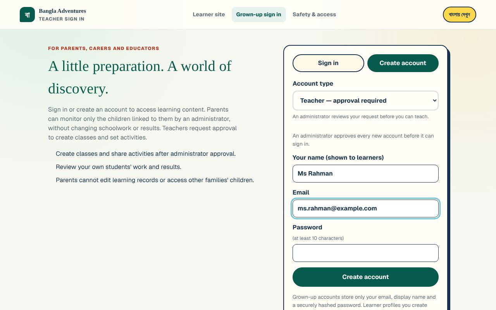

**What you'll see:** a page headed **Account created — waiting for approval**, and a list of
eight **recovery codes**.

8. **Save your recovery codes now.** Select **Copy all codes** and paste them somewhere safe, or
   write them down. They are shown only once. There is no "reset by email" on this platform: a
   recovery code is the only way back in if you forget your password.
9. Select **I’ve saved them — back to sign in**.

You cannot sign in yet. If you try, you will see: *"Your account is waiting for an administrator
to approve it. You can sign in once it is approved."* Let your Administrator know you have asked
for an account. Once they approve it (see
[Approving or declining new accounts](administrator.md#approving-or-declining-new-accounts)),
you can sign in as a teacher.

## Signing in

1. Go to your school's Bangla Adventures address.
2. Under **How will you join us?**, on the **I'm a teacher** card, select **Teacher sign in**.
3. Type your **Email** and **Password**.
4. Select **Sign in**.

**What you'll see:** your **My classes** page, with *"Welcome, (your name)"* at the top.

### Your first sign-in with a temporary password

If your Administrator created your account, sign in as described above, using your email and
the temporary password from your sheet. The first sign-in takes you to a page headed
**Choose your own password**.

1. In **Temporary password**, type the temporary password again.
2. In **New password**, type a new password of at least 10 characters. Only you should know it.
3. Type it again in **Type the new password again**.
4. Select **Save my new password**.
5. The page now says **Your password is changed** and shows **Save your new recovery codes**.
   Select **Copy all codes** and keep them somewhere safe. They replace any codes you were given
   before.
6. Select **I’ve saved them — continue**. You are taken to **My classes**.

If the two new passwords are different, you will see *"The two new passwords do not match."* Type
them again. If you have lost the temporary password, the page tells you: *"Forgot the temporary
password? Ask your administrator to reset it."*

### Signing out

Select **Sign out** at the bottom of the menu on the left. Always sign out on a shared computer.

**What you'll see:** the grown-up sign-in page. The top of the page says **Grown-up sign in**:
teachers, parents and administrators all sign in there, and teachers are taken straight to
**My classes**.

### If you forget your password

1. On the sign-in page, select **Forgot your password? Use a recovery code**.
2. Type your **Email**.
3. Type one unused **Recovery code** from the list you saved.
4. Type a **New password** (at least 10 characters).
5. Select **Reset password**.

**What you'll see:** you are signed in and taken to **My classes**. Use the new password from now
on. As the form explains, the code you used is used up and every signed-in device is signed out.
Cross that code off your list.

If you have no recovery codes left, ask your school's Administrator to reset your password (see
[Resetting a password](administrator.md#resetting-a-password)).

## Your workspace at a glance

The menu on the left is the same on every teacher page. Its items are in two groups, headed
**Teacher workspace** and **Lessons & topics**. On a phone, select **Menu** at the top left to
open it.

| Menu item | What it is for |
| --- | --- |
| **My classes** | Your classes. Open one to work with it. |
| **Home learners** | Optional learner profiles you look after yourself (see [Other pages](#other-pages-in-your-menu)). |
| **Lessons** | Preview the 18 lessons and send in recordings. |
| **Topics** | Write and edit topics, and see what is waiting for approval. |
| **Topics as students see them** | The approved topics, exactly as students see them. |
| **Sources & references** | The textbook (NCTB) links kept by the Administrator. |
| **Account & recovery** | Change your password, recovery codes and other account controls. |
| **Sign out** | Leave Bangla Adventures on this device. |

When a class is open, the menu also shows **Current class** with that class's sections:
**Students**, **Activities & quizzes**, **Results**, **Attendance**, **Announcements** and
**Class sources**.

## Creating and opening a class

1. Select **My classes** in the menu.
2. In the box that says *e.g. Sunday Level 2*, type a name for the class, for example
   *Saturday Bangla Level 2*.
3. Select **Create class**.

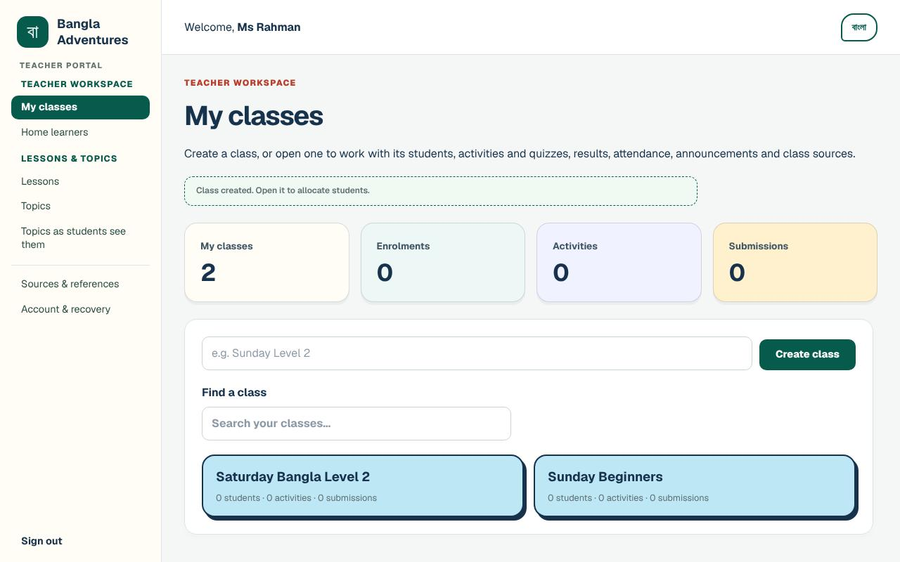

**What you'll see:** *"Class created. Open it to allocate students."* The class appears as a card
showing how many students, activities and submissions it has. The boxes at the top count your
classes, **Enrolments**, **Activities** and **Submissions** across all your classes.

- **To open a class,** select its card. It opens on the **Students** section.
- **To find a class,** type part of its name in **Find a class**.
- **To go back to the list,** select **← My classes** or **My classes** in the menu.
- **To delete a class,** open it and select **Delete class** (top right). You are asked
  *"Delete this class, its activities and submissions?"* Select **OK** only if you are sure.
  You go back to **My classes**, and the class is no longer listed.

Your Administrator can also create a class for you, or hand one of your classes to another
teacher (see
[Classes: creating them and handing them over](administrator.md#classes-creating-them-and-handing-them-over)).

## Adding students by searching and ticking

Use this for students who already have an approved account (for example, students who signed up
themselves and were approved by your Administrator).

1. Open the class. The **Students** section is shown first.
2. Under **Allocate students**, type part of a student's name or username in **Find students**.
   The list below shows matching students. (Before you type, it shows every student you can
   add.)
3. Tick each student you want. Your ticks are kept while you search for more names.
   - **Select all shown** ticks everyone in the list.
   - **Clear selection** removes all your ticks. It appears once you have ticked someone.
4. Select **Add selected** (the button shows how many you have ticked, for example
   **Add selected (3)**).

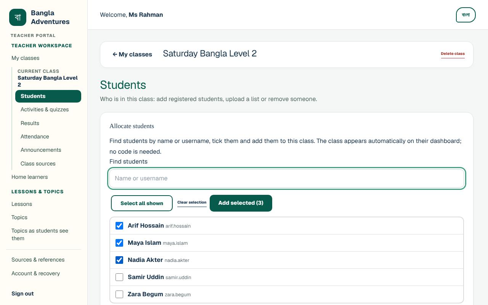

**What you'll see:** *"3 students added to this class."* They now appear under
**Students in this class**. The class appears on each student's own dashboard automatically. No
class code is needed.

Only approved, active students who are not already in the class are listed. If a student is
missing, see [Troubleshooting](#troubleshooting).

### Removing a student from a class

1. Under **Students in this class**, find the student and select **Remove allocation**.
2. You are asked to confirm. The message explains that the student leaves the class list, results
   and attendance, but their work is kept and comes back if you add them again.
3. Select **OK**. You will see, for example, *"Zara Begum was removed from this class."*

## Adding students from a CSV class list

Use this to add a whole class list at once. Each new student gets an account, a username and a
temporary password. Students who already have an account can be added by their username.

### The CSV format

A CSV file is a simple spreadsheet saved as plain text, with commas between the columns. You can
make one in Excel, Google Sheets or Numbers by saving or downloading the sheet as **CSV**.

The file must look like this:

```csv
name,username
Imran Ali,
Lina Roy,lina.roy
```

The rules the app checks are:

- **The first row is a header.** It must have a **name** column (*student name* or *display name*
  also work). A **username** column is optional. No other columns are allowed.
- **One student per row,** up to 200 students in one file.
- **Leave the username empty** to let the app make one from the name. It adds a number, for
  example *Imran Ali* became *imran.ali3605*.
- **A username you type** must be 3–40 letters, numbers, dots, dashes or underscores. No spaces.
- **If a row has the username of a student who already has an account,** that student is added
  to the class and keeps their own password.
- **If a name has a comma in it,** put the name in double quotes, for example
  `"Chowdhury, Rafi",`

To start from a ready-made file, open the class and select **Download the CSV template**. It
contains:

```csv
name,username
Maya Rahman,
Arif Hossain,arif.hossain
```

Replace the example names with your students before uploading.

### Uploading the list

1. Open the class. Scroll down the **Students** section to **Add students from a CSV file**.
2. Under **Student list (CSV file)**, choose your CSV file.
3. Select **Upload and create accounts**.

**What you'll see:** for example *"2 student accounts created and added to this class."* and a
**Student sign-in sheet** with each student's **Name**, **Username** and **Temporary password**.
The sheet also tells students the address to sign in at. If the file listed students who
already had an account, they are shown separately under **Already had an account**. They keep
their own password, so they are not on the sign-in sheet.

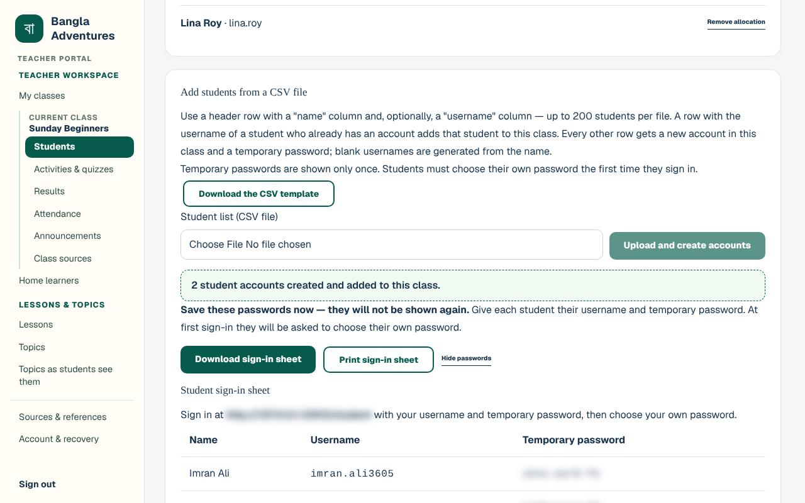

4. **Save the passwords now. They will not be shown again.** Do one or both of these:
   - Select **Download sign-in sheet** to save it as a file (*student-sign-in-sheet.csv*).
   - Select **Print sign-in sheet** to print it.
5. Give each student (or their parent) their username and temporary password privately.
6. When you have saved or printed the sheet, select **Hide passwords** and confirm.

If you try to leave the class while the passwords are still on screen, you are asked: *"Discard
the temporary passwords on screen? Download or print the sign-in sheet first — they cannot be
shown again."*

The first time each student signs in, they are asked to **Choose your own password** (see
[First sign-in](student.md#first-sign-in-choosing-your-own-password) in the Student guide).

### If the upload is refused

Nothing is created until the whole file is correct. You will see *"Nothing was created. Fix the
rows listed and upload the file again."* and a list of the rows to fix, for example:

- *Line 3: Enter the student's name.*
- *Line 4: Username "tanvir ahmed" must be 3–40 letters, numbers, dots, dashes or underscores.*
- *Line 1: The first row must be a header with a name column ("name", "student name" or "display
  name") and, optionally, "username". Found: "student".* (The end of the message shows what your
  first row says.)
- *Line 1: Unknown column "age". Use only "name" and, optionally, "username".*

If a name matches a student who already has an account, you will see a message such as *"A
student named "Zara Begum" already has an account (zara.begum). To add them, write their username
in the "username" column. If this is a different child, tick "Create new accounts for matching
names too" and upload again."*

- If it **is** the same child, put their username in the file and upload again.
- If it is a **different** child with the same name, tick **Create new accounts for matching
  names too** and upload again.

## Setting activities and quizzes

An activity is a short multiple-choice quiz for your class. Each activity is checked by your
Administrator before students can see it, unless the Administrator has switched that approval off
(see [Whether your activities and sources wait for approval](#whether-your-activities-and-sources-wait-for-approval)).

1. Open the class and select **Activities & quizzes**.
2. Under **Set a quiz or activity**, type a title in the box that says *Activity title, e.g.
   Festivals check-in*.
3. If you like, type instructions in the box that says *Instructions for students (optional)*.
4. If you like, choose a topic under **Link a classroom topic (students get a 'read this first'
   pointer):**. Only approved topics are listed.
5. Under **Question 1**, type the question, then type the answers in **Option 1** and
   **Option 2**.
6. Select the round button next to the **correct answer**.
   - **+ Add option** adds another answer. **✕** next to an answer removes it.
   - **+ Add question** adds another question.
   - **Remove question** removes a question (it appears when there is more than one).
7. Select **Submit for Admin approval**.

**What you'll see:** *"Activity submitted for Admin approval. Students and parents cannot see it
yet."* The activity appears under **Activities & submissions** with the line **Awaiting Admin
approval · not published**.

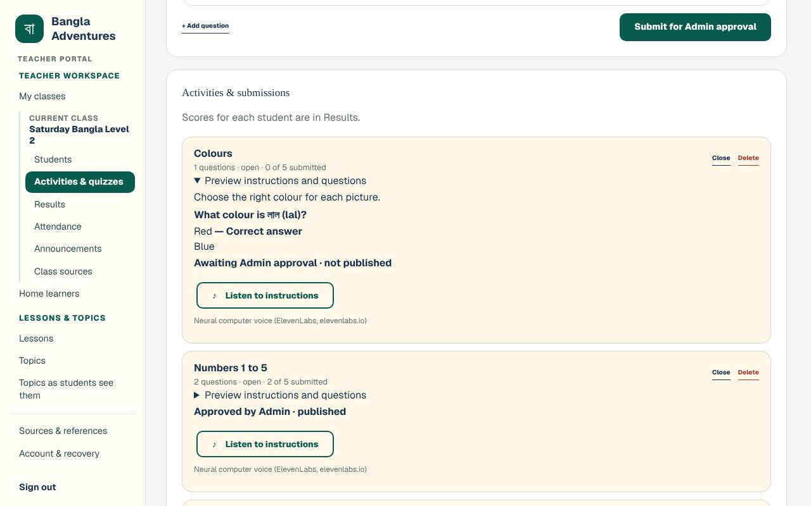

After the Administrator's decision (see
[Class activities and class sources](administrator.md#class-activities-and-class-sources) in the
Administrator guide), the line changes to one of these:

- **Approved by Admin · published** — your students can now answer it.
- **Changes requested · not published** — read the **Review note** under it. Select
  **Revise as a new activity** to copy it into the form. You will see *"A copy is ready in the
  form below. Edit it and submit it for a new Admin review; the original and its results are
  retained."* Make your changes and select **Submit for Admin approval** again.

Other buttons on each activity:

- **Preview instructions and questions** shows the questions with the correct answers marked.
- **Close** stops students from sending answers (the activity shows *closed*). **Reopen** opens
  it again.
- **Delete** removes the activity and its submissions, after you confirm.

## Reading results: the gradebook

1. Open the class and select **Results**.

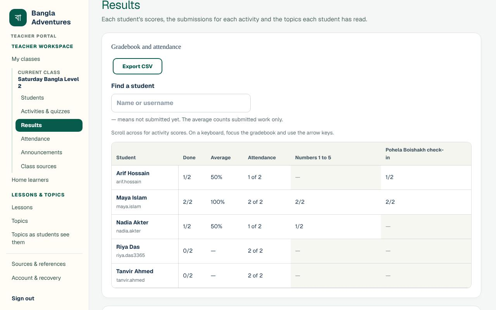

**What you'll see** under **Gradebook and attendance**:

- **One row for each student** in the class, in alphabetical order, with their username in small
  print.
- **Done** — how many activities the student has submitted, out of the total (for example *1/2*).
- **Average** — the average score of the work they **have** submitted.
- **Attendance** — sessions attended, for example *1 of 2*. It shows — until you take
  attendance for that student.
- **One column for each activity**, newest first, showing the score (for example *2/2*).
- **—** means the student has not submitted that work yet. A real score of zero shows as *0/2*,
  not —.
- An activity that students cannot see yet (still waiting for Administrator approval, or sent
  back with **Changes requested**) has no column and is not counted in **Done**. A note above
  the table says so, for example *"1 activity is not published yet (waiting for approval or
  changes requested). Students cannot see it, so it is not shown here or counted in Done."*

Useful tools:

- **Find a student** — type part of a name or username to show only matching rows.
- **Export CSV** — downloads the results as a spreadsheet file named after the class (for example
  *Saturday Bangla Level 2-grades.csv*). It has one row per submission, plus a row for each student
  who has submitted nothing.
- With many activities, scroll the gradebook sideways to see them all (the page says *"Scroll
  across for activity scores."*).

Further down the **Results** section:

- **Submissions by activity** — select the button on an activity, for example
  **2 of 5 submitted**, to see every student's **Score** and when they **Submitted**. Students who
  have not submitted show *Not submitted*. A student hands in each activity once and cannot
  change their answers afterwards. **Reset** removes one student's submission, after you
  confirm, so that it shows — again and the student can do the activity again while it is open.
- **Topics read** — for each student: **Topics read**, **Topic quizzes done** and
  **Topic quiz average**. A topic counts as read when the student marks it complete or finishes
  its quiz. Quiz results are each student's best score, from at most the first 3 tries at each
  topic's quiz a day; later tries that day are practice and are not saved.

## Taking attendance

1. Open the class and select **Attendance**.
2. Check the **Class date**. It starts on today's date. To record another day, pick that date. The
   box shows dates in your computer's usual format.
3. Everyone starts **ticked as present**. **Untick** each student who was absent.
4. Check the count at the bottom, for example *"4 of 5 present"*. Until you save it also says
   **Changes not saved yet**.
5. Select **Save attendance for** (the button shows the date, for example
   **Save attendance for Sat, 31 Oct 2026**).

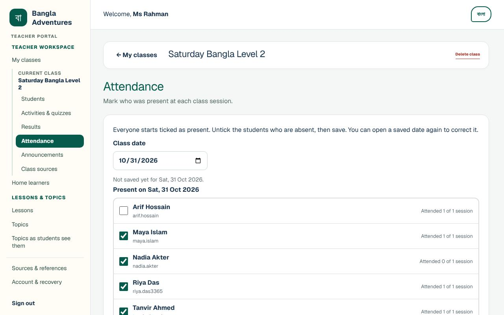

**What you'll see:** *"Attendance saved for Sat, 31 Oct 2026: 4 of 5 present."* and *"Last saved
by Ms Rahman at …"*. Next to each student you can see their total so far, for example *"Attended 1
of 2 sessions"*. The date also appears under **Past sessions** with how many were present.

- **To correct a day,** select **Open** next to it under **Past sessions** (or pick the date
  again), change the ticks and save again.
- **If you change the date before saving,** you are asked *"These attendance changes are not saved
  yet. Discard them?"* Select **Cancel** to stay and save first.
- **Students added to the class after a saved date** show *"Not recorded for this date"* on that
  date. Select **Record for this date** only if they were at that class.

Attendance totals also appear in the **Attendance** column of the gradebook. Students and their
linked parents see them too (see [Attendance](student.md#attendance) in the Student guide and
[Reading results and attendance](parent.md#reading-results-and-attendance) in the Parent guide).

## Posting announcements

1. Open the class and select **Announcements**.
2. Type your message in the box (up to 2,000 characters; a counter shows how many you have used).
3. Under **Who can see it**, choose one of:
   - **Everyone in the class (students and parents)**
   - **Students only**
   - **Parents only**
4. Select **Post**.

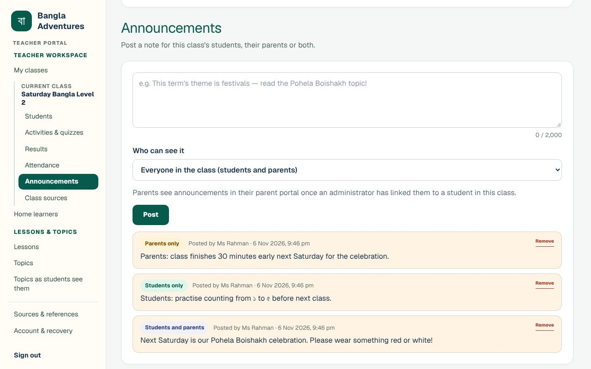

**What you'll see:** a message such as *"Announcement posted to the parents."* The announcement
appears in the list with a label showing who can see it: **Students and parents**,
**Students only** or **Parents only**, and *"Posted by (your name)"* with the date and time.

Good to know:

- **Your choice under Who can see it stays the same for your next post.** Check it each time.
- Students see *Everyone* and *Students only* posts. Parents see *Everyone* and *Parents only*
  posts. Students never see *Parents only* posts, and parents never see *Students only* posts.
- Parents only see announcements once the Administrator has linked them to a student in the class
  (see [Linking a parent to a student](administrator.md#linking-a-parent-to-a-student)).
- **To remove a post,** select **Remove** and confirm. Students and parents will no longer see it.

Announcements do not need Administrator approval. They appear as soon as you post them.

## Adding class sources

Class sources are useful links just for your class, such as a worksheet, a video or a textbook
page. Each link is checked by the Administrator before students and parents can see it, unless the
Administrator has switched that approval off (see below).

1. Open the class and select **Class sources**.
2. Under **Add a source**, fill in:
   - **Title (English)** and/or **Title (Bangla)** — give a title in at least one language.
   - **Link** — the web address. It must start with **https://**.
   - **Note for students (optional)**.
3. Select **Submit source for Admin approval**.

**What you'll see:** *"Source submitted for Admin approval. Students and parents cannot see it
yet."* The link appears in the list with **Awaiting Admin approval · not published**.

Once the Administrator approves it, it shows **Approved by Admin · published**. Students in the
class then see it on their **Sources & references** page, and their linked parents see it on
their **My children** page (see [Opening class sources](parent.md#opening-class-sources) in the
Parent guide).

- **To change a link,** select **Edit**. The form changes to **Edit source**. Make your changes
  and select **Submit source for Admin approval** (or **Cancel** to leave it as it was). You will
  see *"Source updated and submitted for Admin approval. It is hidden until approved again."*
  Students do not see it until it is approved again.
- **To remove a link,** select **Remove** and confirm. You will see *"Source removed."*

The NCTB textbook links that everyone sees are looked after by the Administrator, not by
teachers (see
[Keeping the NCTB textbook links up to date](administrator.md#keeping-the-nctb-textbook-links-up-to-date)).

### Whether your activities and sources wait for approval

The note above each form in your class says what happens when you save. Normally an activity or
source waits for the Administrator, as described above. The Administrator can switch off
**Teachers' class activities need an administrator's approval** or **Teachers' class sources need
an administrator's approval** (see [Who needs approval](administrator.md#who-needs-approval) in
the Administrator guide). Then:

- **Activities & quizzes** says *"An administrator has switched off approval for teachers' class
  activities, so your new activities are published to the class as soon as you save them."* The
  button is **Publish to the class**, and after saving you see *"Activity published to the class.
  Students and parents see it now, and students can answer it while it is open: teachers' class
  activities do not need an administrator's approval at the moment."* The activity shows
  **Approved · published**. **Close** and **Reopen** work as before: students answer only while it
  is open.
- **Class sources** says *"An administrator has switched off approval for teachers' class
  sources, so a source you add or edit is shown at once to allocated students in Sources &
  references and to their linked parents."* The button is **Save and show to the class**. After
  adding a link you see *"Source published. Students in this class and their parents can see it
  now: teachers' class sources do not need an administrator's approval at the moment."*, and after
  an edit *"Source updated. Students in this class and their parents see the change now: …"*.

Everything you publish this way is still recorded, and the Administrator can send it back at any
time. Activities and sources that were already waiting when approval was switched off keep
waiting until the Administrator reviews them; editing a waiting source publishes your edit. When
the Administrator switches approval on again, only what you save from then on waits.

## Writing topics in English and Bangla

A topic is a short reading with an optional quiz, for example about a festival or a place.
Every topic is written in English and Bangla. Topics are shared by the whole school, not one class.

### Writing a new topic

1. In the menu, under **Lessons & topics**, select **Topics**.
2. Select **+ New topic**. The form **Write a new topic** opens.
3. Fill in the top of the form:
   - **Category** — for example *Our country — symbols, rivers & nature*.
   - **Card emoji** — one picture symbol for the topic card.
   - **Reading time (minutes)**.
   - **Title (English)** and **Title (Bangla)**.
   - **Short introduction (English)** and **Short introduction (Bangla)**.
4. Under **Reading sections**, fill in **Section 1 heading** and **Section 1 text**, in English
   and in Bangla. Select **+ Add a section** for more.
5. If you like, add **“Did you know?” facts (optional)** with **+ Add a fact**.
6. If you like, add a quiz under **Quiz (optional, up to 10 questions)**:
   1. Select **+ Add a quiz question**.
   2. Type the question and each answer in English and in Bangla.
   3. Select **Correct answer** under the right answer.
   4. Select **+ Add an answer** for more answers.
7. If you like, say where the content comes from under **Source note (optional)**, in both
   languages.
8. Select **Submit for administrator review**. (Select **Cancel** to leave without saving.)
   If a box that must be filled in is still empty, the page jumps to it and asks you to fill
   it in. If the Administrator has switched off approval for teachers' topics, the note at the
   top of the form says *"An administrator has switched off approval for teachers' topics, so
   students see your topic as soon as you save it."* and the button is **Save and publish to
   students** instead.

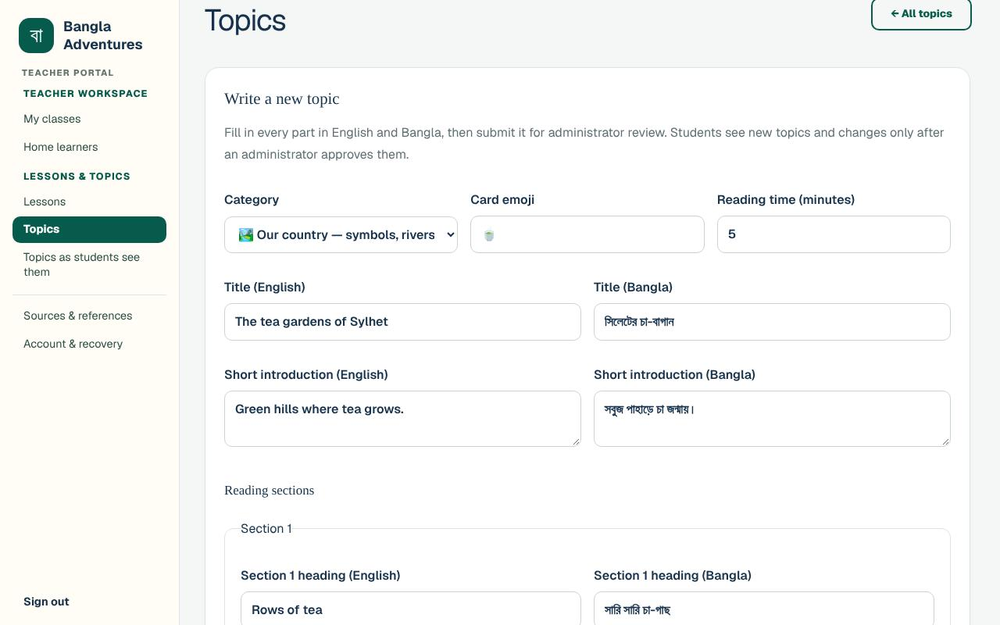

### Previewing your topic

**What you'll see** after submitting: *"Submitted as version 1 for administrator review. Students
will not see this version until an administrator approves it."* Below it is a full preview. (With
approval switched off you see *"Published as version 1. Students see it now: teachers' topics do
not need an administrator's approval at the moment."* instead.)

1. Scroll down to **Student view preview**.
2. Choose **English**, **বাংলা** or **Side by side** to check both languages, including the quiz.

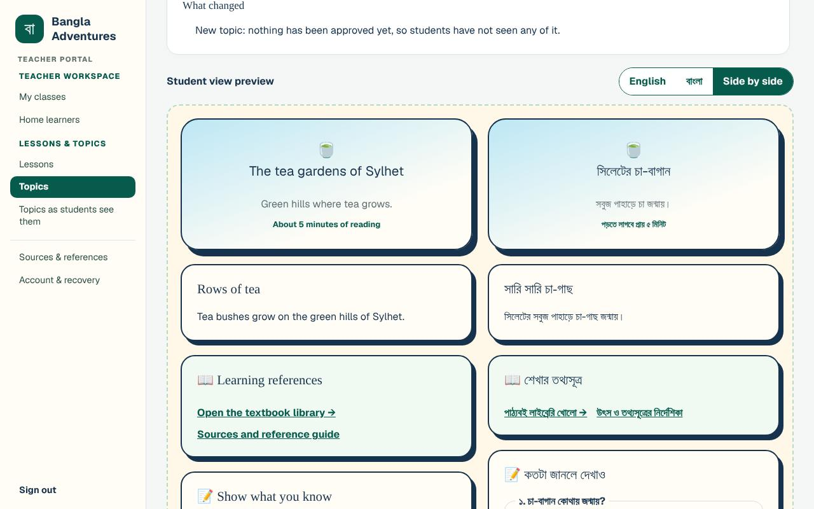

The page also shows **What changed** and a **Version history** table. To fix something, select
**Edit this topic**, make your changes and submit again.

### Following your topic

Select **← All topics** to go back to the list. While it waits for the Administrator (see
[Topics](administrator.md#topics) in the Administrator guide), your topic is listed at the top
under **Waiting for approval**, with **Preview submission** and **Edit**. Every topic is also
listed further down under its category, with **Preview & history** and **Edit**. The label under
the title tells you where it is:

- **New · waiting for approval** — not seen by students yet.
- **Sent back · not published** — the Administrator wants changes. The topic is no longer under
  **Waiting for approval**; find it under its category. Open it with **Preview & history** or
  **Edit** to read their note, for example *"Sent back by (Administrator): Please add a second
  section about the tea pickers."* (the preview also shows the date). Then edit it and submit it
  again.
- **Approved** — students can read it.
- **Approved · new version waiting** — you edited an approved topic. Students keep seeing the
  approved version until the Administrator approves your changes. The preview's **What changed**
  box lists your changes.

You can also edit any existing topic with **Edit**, and look at any topic with
**Preview & history** or **Preview submission**. Teachers cannot approve topics: only the
Administrator approves.

### Whether your topics wait for approval

The paragraph at the top of the **Topics** page says what happens when you save a topic:

- *"Write or edit a topic, then submit it for administrator review. Your new topics and changes
  reach students only after an administrator approves them."* This is the normal setting.
- *"An administrator has switched off approval for teachers' topics, so your new topics and edits
  are published to students as soon as you save them."* The Administrator has switched off
  **Teachers' topics need an administrator's approval** (see
  [Who needs approval](administrator.md#who-needs-approval) in the Administrator guide). Each
  topic you publish this way is still recorded, and its **Version history** says *"Published at
  once (teachers' topics did not need approval)"*.

When approval is switched off, topics that were already waiting stay under **Waiting for
approval** until the Administrator reviews them; the page says how many. An edit of a topic the
Administrator withdrew always waits for the Administrator.

To see the approved topics exactly as students see them, select **Topics as students see them**
in the menu.

## Previewing lessons

Bangla Adventures has 18 lessons. You can preview every one of them, with the Bangla
transcripts, English support and correct answers shown, whether or not it has been approved yet.

1. In the menu, under **Lessons & topics**, select **Lessons**.
2. The **Lessons** page lists the lessons by category. Each shows its status, for example
   **Approved** or **Waiting for approval · hidden from students**.
3. Select **Preview lesson** next to a lesson.

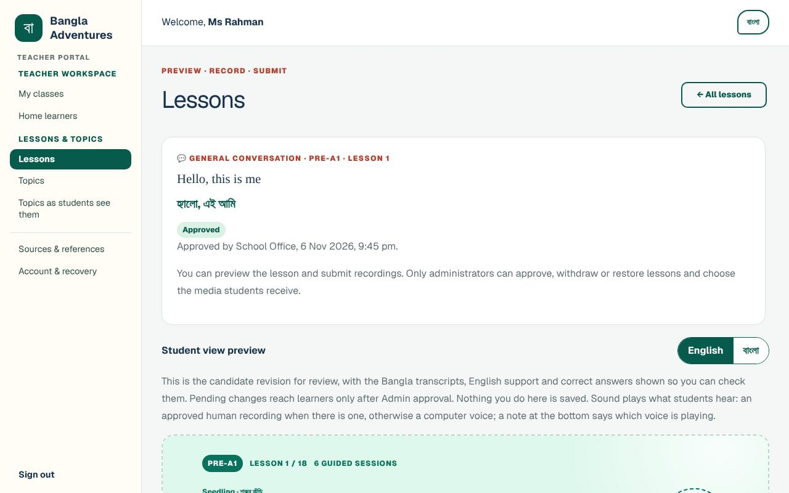

**What you'll see:**

- **At the top** — the lesson's title in English and Bangla and its status, for example
  **Approved** with *"Approved by (Administrator), (date)."*, or
  **Waiting for approval · hidden from students** with *"Nobody has approved this lesson yet, so
  students cannot see it."*
- **Student view preview** — the lesson as students see it. Use **English** and **বাংলা** to switch
  its language, and the lesson's own tabs (*Overview, Listen, Read, Speak, Write, Watch, Mastery*)
  to move around. Nothing you do in the preview is saved.
- **Approval history** — the decisions made on this lesson.
- **Video check** — what the Administrator decided about the lesson's video. Only an
  Administrator can approve, replace or remove a video (see
  [Lesson videos](administrator.md#lesson-videos-a-separate-decision) in the Administrator guide).

Select **← All lessons** to go back.

### Specialist checks (optional)

At the bottom of a lesson, **Detailed specialist checks (optional)** lets staff record internal
notes, for example a Bangla language check.

1. Select **Detailed specialist checks (optional)** to open it. The number after it, for
   example **(0)**, is how many checks have been saved.
2. Under **Record your check**, choose the **Check** (for example *Bangla language*) and the
   **Status** (for example *Check complete*).
3. Type the **Reviewer name** and any **Notes**.
4. Select **Save check**. You will see *"Check saved."* and your check is listed in a table
   above the form.

A specialist check is a note only. It does not publish anything.

## Sending in a recording

You can record a real voice for parts of a lesson. Learners hear a computer voice until an
Administrator approves a human recording.

Before you start, make sure the speaker agrees to the recording being used and credited. For a
child, a parent or guardian must agree too.

1. Open the lesson (see [Previewing lessons](#previewing-lessons)).
2. Scroll to **Human audio recordings** and select **Upload a recording**.
3. Choose the **Part of the lesson**, for example *Complete dialogue* or *Vocabulary word 1*.
4. Type the **Speaker name (for the credit)**.
5. Type the **Dialect or way of speaking**, for example *Standard Bangla (Dhaka)*.
6. Under **Audio file (MP3, WAV, OGG, M4A or WebM, up to 12 MB)**, choose the recording.
7. Tick **The speaker (and a guardian, for a child) agreed to this use and credit.**
8. Select **Upload for review**.

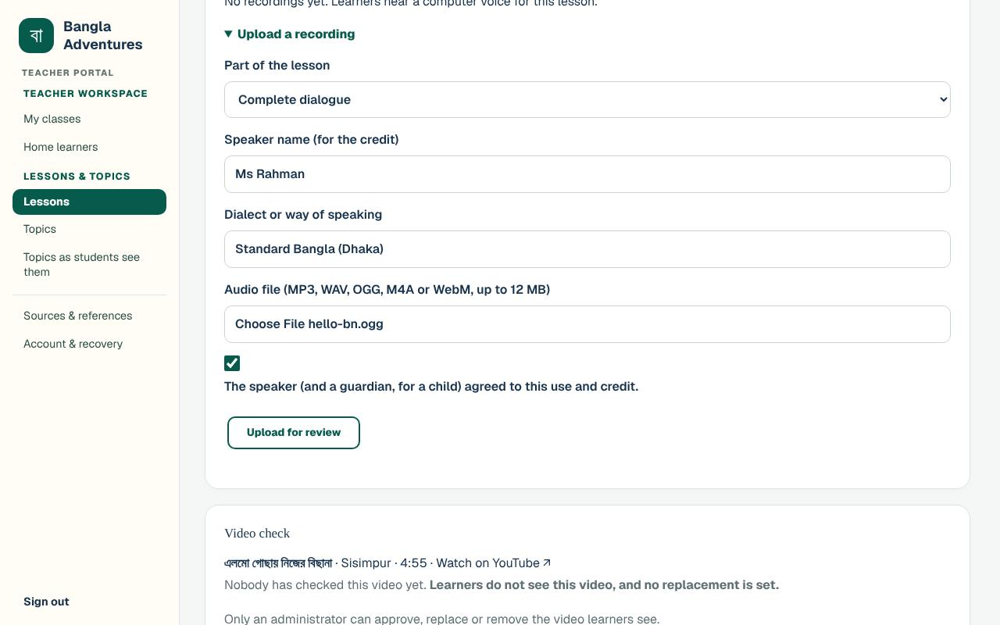

**What you'll see:** *"Uploaded for administrator review. Learners will hear it only after an
administrator listens and approves it."* The recording is listed with *Waiting for review*, the
speaker, the dialect and *consent confirmed*. It also appears on the **Lessons** page under
**Recordings waiting for review**, with **Preview in the lesson**. The Administrator then listens
to it (see [Recordings of real voices](administrator.md#recordings-of-real-voices)).

## Other pages in your menu

- **Home learners** — an optional space to guide a learner without giving them an account. You
  create a learner profile with a **Display name** (a first name, nickname or initials is enough),
  a **Broad age band** and **Languages used**, then select **Create learner profile**. No child
  email, birthday, photo or school is asked for. These profiles are separate from your classes.
- **Sources & references** — the National Curriculum and Textbook Board (NCTB) books that topics
  draw on, with links to each book. The Administrator keeps these links up to date.
- **Topics as students see them** — the approved topics only, as students see them.

## Looking after your account

Select **Account & recovery** in the menu. The page is headed **Your data, in your hands.**

- **Change password** — type your **Current password** and a **New password**, then select
  **Change password**. You will see *"Password changed. Any other signed-in devices have been
  signed out."* If the current password is wrong, you will see *"Your current password is
  incorrect."*
- **Download data export (JSON)** — downloads a copy of what is stored for your account
  (*bangla-adventures-export.json*).
- **Sign out everywhere** — signs your account out on every device, including this one, and
  takes you back to the welcome page. Use it if you think you stayed signed in on a shared or
  public computer.
- **Generate new recovery codes** — type your **Current password** and select
  **Generate new recovery codes**. Eight new codes appear with *"Save these now — they are shown
  only once."* Your old codes stop working. Do this when you are running out of codes.
- **Delete account** — permanently removes your account and everything it owns. It asks for your
  **Current password** and for you to type **DELETE**, then you select
  **Permanently delete account**. It cannot be undone. Talk to your Administrator before you use
  it: while you still teach a class the account cannot be deleted, so the Administrator first
  gives your classes to another teacher.

## Switching language

Bangla Adventures works in English and Bangla.

- **In your teacher workspace,** select **বাংলা** at the top right. Menus, buttons and messages
  change to Bangla, and the button changes to **English**. Select **English** to switch back.
  Bangla Adventures remembers your choice on the next page and after you reload.
- **On the sign-in page,** select **বাংলায় দেখুন** at the top right. To switch back, select
  **View in English**.
- **In topic and lesson previews,** use the preview's own **English** and **বাংলা** buttons
  (and **Side by side** for topics). These change only the preview.

Names you type, such as class names and student names, stay exactly as typed.

## Privacy and safety

**What you can see**

- **Your own classes only.** Other teachers' classes do not appear in your **My classes**, and you
  cannot open them.
- **Results, attendance and topics read** for the students in your own classes.
- **When adding students,** the **Find students** list shows the name and username of every
  approved, active student on the platform who is not already in that class. It shows no results,
  attendance or other details.
- **All shared topics and all 18 lessons,** including those still waiting for approval.

**What you cannot do**

- **Publish anything yourself.** Activities, topics, lessons, recordings and class sources all
  wait for the Administrator, except topics, activities and class sources while the Administrator
  has switched off approval for that kind of work. You will not find approve buttons on your
  pages.
- **Open Administrator pages.** If you try, you will see **Administrator access required**.
- **Reset a student's password.** Temporary passwords from a CSV upload are shown once only. If a
  student loses theirs, ask the Administrator.
- **Link parents to students.** Only the Administrator does this.

**Keeping things safe**

- **Hand out temporary passwords privately,** and keep or destroy printed sign-in sheets safely.
- **Only upload recordings when the speaker has agreed** to the use and credit (and a guardian,
  for a child). The upload form asks you to confirm this.
- **Sign out on shared computers,** and use **Sign out everywhere** if you are unsure.
- **Keep your recovery codes private.** Anyone with your email and a code can set a new password.
- **Removing a student from a class keeps their work.** It comes back if you add them again.

## Troubleshooting

| What you see or what happens | What it means | What to do |
| --- | --- | --- |
| *"Your account is waiting for an administrator to approve it. You can sign in once it is approved."* | Your teacher request has not been approved yet. | Ask your Administrator to approve it, then sign in again. |
| *"An administrator has not approved this account. Please contact your administrator."* | Your request was declined. | Contact your Administrator. They can approve the account later. |
| *"That email and password do not match."* | The email or password is wrong. | Check for typing mistakes and Caps Lock. If you have forgotten your password, use a recovery code. |
| *"Too many attempts. Please wait 15 minutes and try again."* (the time can differ) | There were too many wrong passwords or recovery codes in a row. | Wait for the time it says, then try again carefully. |
| *"This account is suspended. Please contact the administrator."* | Your password was right, but the Administrator has suspended the account. | Contact your Administrator. |
| *"New narration is made only for approved, open activities. Saved audio still plays."* | You selected a listen button on one of your activities that is waiting for approval, sent back or closed, and no audio was saved for it yet. | Listen again once the activity is approved and open. |
| *"You still teach classes. Ask an administrator to move them to another teacher before deleting this account."* | Your account still teaches one or more classes. | Ask your Administrator to give your classes to another teacher (or delete them) first. |
| *"That email and recovery code do not match, or the code was already used."* | The recovery code is wrong or already used. | Try another unused code from your list. If none are left, ask your Administrator. |
| *"The two new passwords do not match."* | The two new passwords are different. | Type the same new password in both boxes. |
| *"Your current password is incorrect."* | On **Account & recovery**, the current password is wrong. | Type your current password again. |
| A student is not in the **Find students** list, or you see *"No student who can be added matches this search. Only approved, active students who are not in this class are listed."* | The student is already in the class, has no account, or their account is not approved yet. | Check **Students in this class**. Otherwise ask the Administrator to approve the student, or add them with a CSV class list. |
| *"Nothing was created. Fix the rows listed and upload the file again."* | Something in the CSV file needs fixing. | Fix each line listed and upload the whole file again. See [If the upload is refused](#if-the-upload-is-refused). |
| You left the page before saving the temporary passwords. | They cannot be shown again. | Ask the Administrator to help the students affected. |
| *"Enter a public HTTPS link (https://…) without a password in it."* | A class source link does not start with **https://**. | Copy the full address from your browser's address bar. It must start with **https://**. |
| *"Speaker credit and recorded consent confirmation are required."* | A recording was sent without the speaker's name or without the consent tick. | Fill in **Speaker name (for the credit)**, tick the consent box and select **Upload for review** again. |
| Students cannot see your activity, topic, recording or class source. | It is still **Awaiting Admin approval** or was sent back. | Check its status line. Ask the Administrator to review it, or read their note and resubmit. |
| A student cannot answer an activity. | The activity may be closed, or not approved yet. | Check **Activities & quizzes**. Select **Reopen** if you closed it. |
| *"These attendance changes are not saved yet. Discard them?"* | You changed the date or left the page before saving attendance. | Select **Cancel**, then save the attendance. |
| A parent cannot see your announcement. | It was posted to **Students only**, or the parent is not linked to a student in the class. | Post it again for **Everyone** or **Parents only**. Ask the Administrator to link the parent. |

## Getting help

- For any problem with your account, your classes or approvals, contact **your school's
  Administrator**. They can approve accounts, link parents to students, review your activities,
  topics, recordings and class sources, and help students who have lost their passwords.
- The [Administrator guide](administrator.md) shows what the Administrator does with what you
  submit. The [Student guide](student.md) and [Parent guide](parent.md) show what your students
  and their parents see.
- The [user guides index](README.md) lists the guides for every role.
